# FamiliarMac

**A familiar Linux desktop for people who already know their Mac.**

[🇹🇷 Türkçe](docs/README.tr.md) · [Install](docs/INSTALL.md) · [All changes](docs/CHANGES.md) · [Sources & licenses](THIRD_PARTY.md) · [Known limitations](STATUS.md)

A Mac can remain useful long after its supported macOS releases stop arriving. Linux can extend its life, but changing a familiar interface can make everyday tasks unnecessarily difficult.

This project began when I installed Linux on my father's MacBook. He was used to macOS and struggled to find settings and familiar actions. FamiliarMac collects the themes, shortcuts and desktop integrations we built to make that transition easier. It is also a reproducible record for reinstalling my own machine after a format.

FamiliarMac changes the **interface and interaction**, not the operating system into macOS. It combines credited upstream projects with integration code and fixes. It is not a new distribution, an Apple product, or a universal macOS compatibility layer.

## Screenshots

Feature close-ups cropped from the installed desktop. Click an image to open the full capture. Network and account names are redacted where needed.

[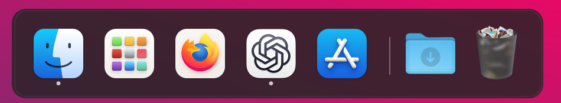](docs/screenshots/apps.png)

| About this Mac | Applications |
| --- | --- |
| [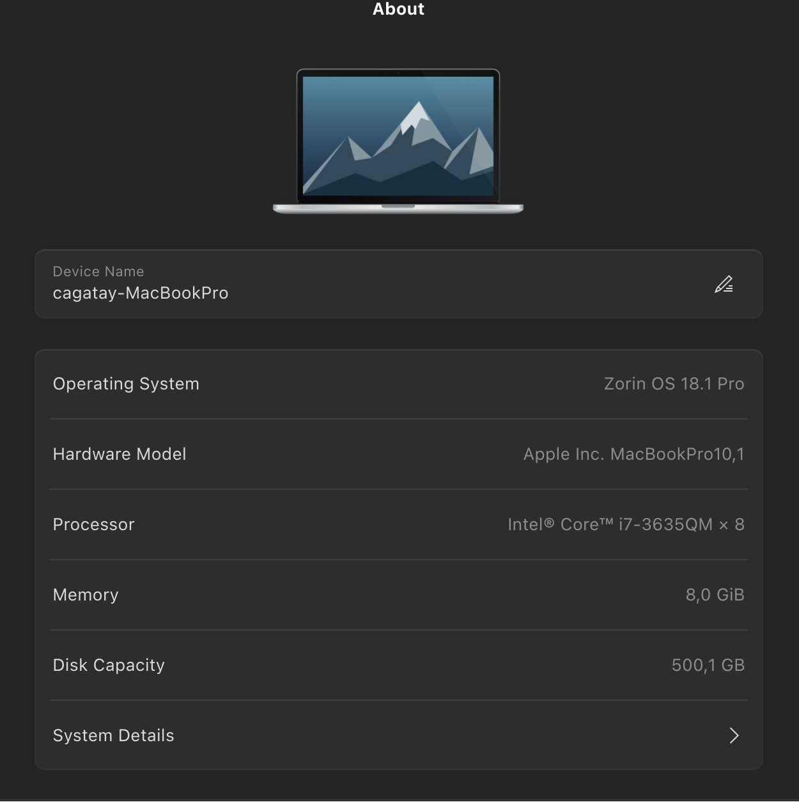](docs/screenshots/about.png) | [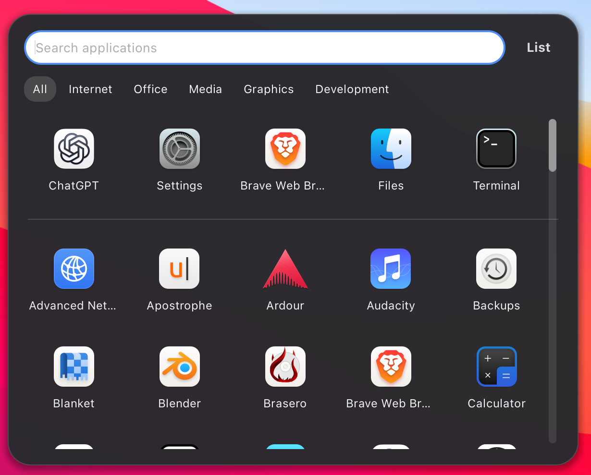](docs/screenshots/apps.png) |

| Spotlight search | Calculator |
| --- | --- |
| [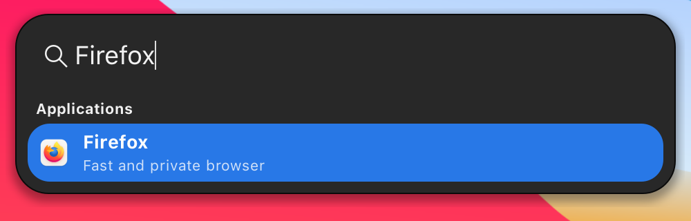](docs/screenshots/spotlight-search.png) | [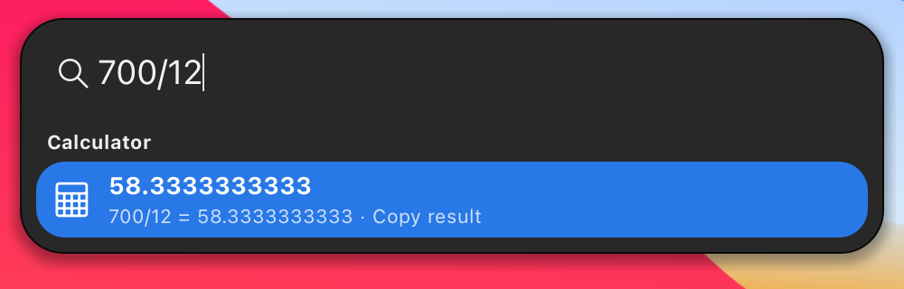](docs/screenshots/spotlight-calculator.png) |

| Control Center | Notification Center |
| --- | --- |
| [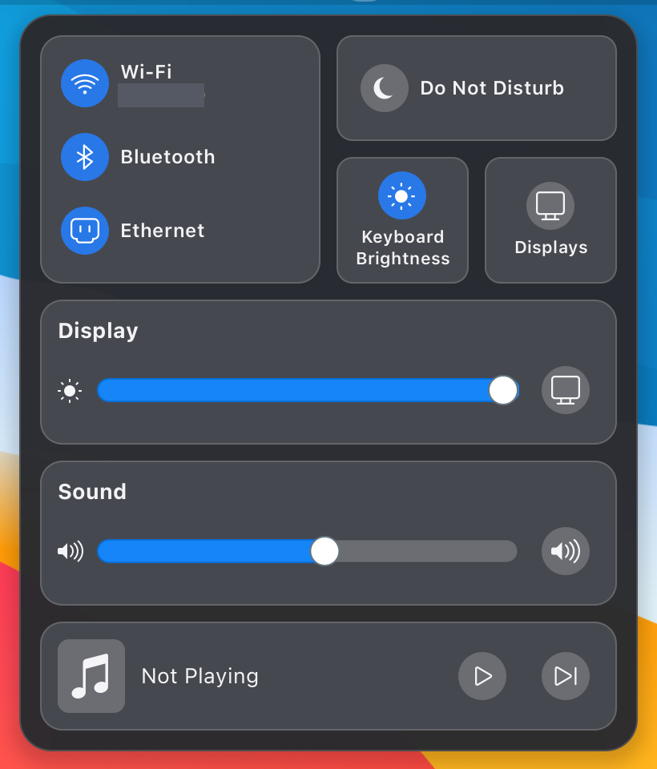](docs/screenshots/control-center.png) | [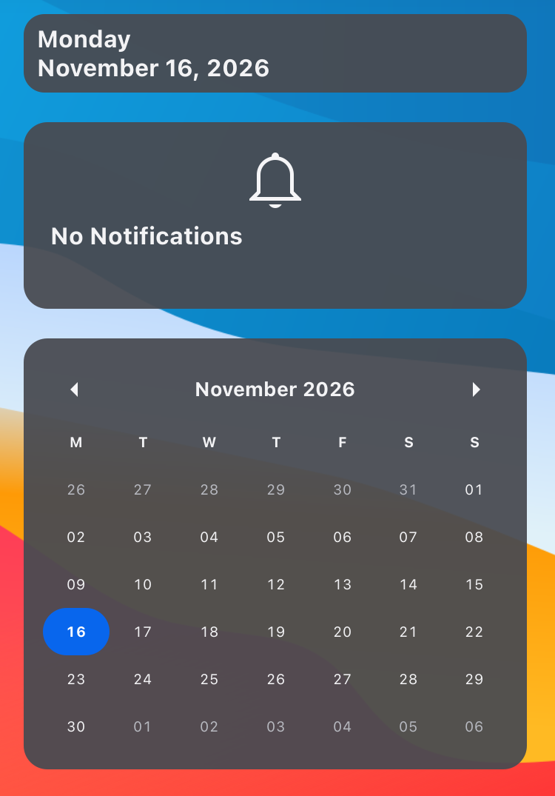](docs/screenshots/notifications.png) |

| Wi-Fi | Sound |
| --- | --- |
| [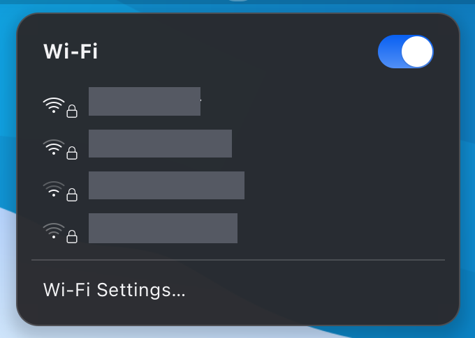](docs/screenshots/wifi.png) | [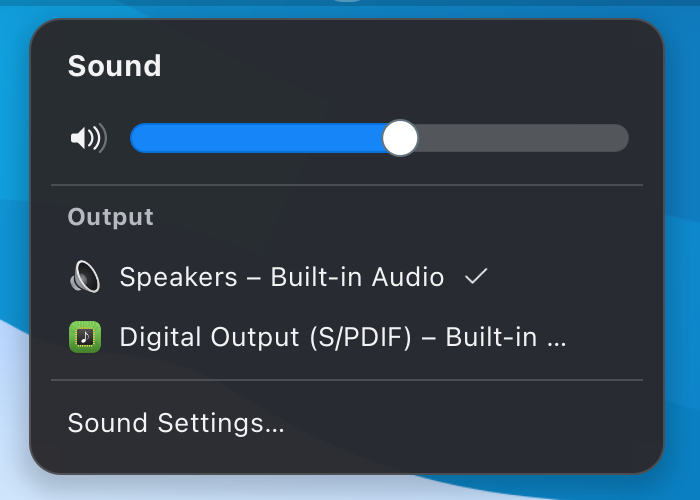](docs/screenshots/sound.png) |

| Display brightness | Volume indicator | Keyboard backlight |
| --- | --- | --- |
| [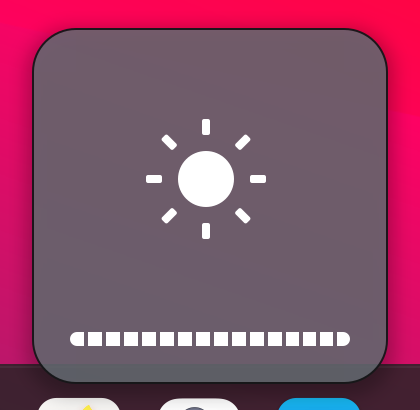](docs/screenshots/brightness-osd.png) | [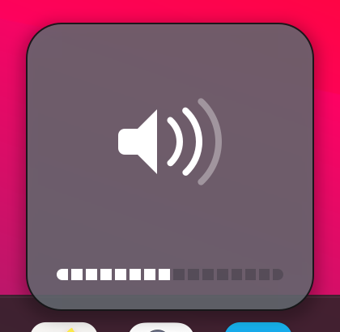](docs/screenshots/sound-osd.png) | [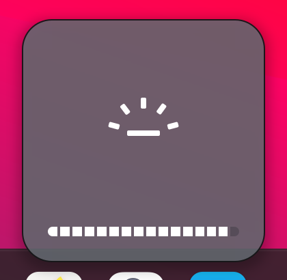](docs/screenshots/keyboard-osd.png) |

| System and power menu | Restart confirmation |
| --- | --- |
| [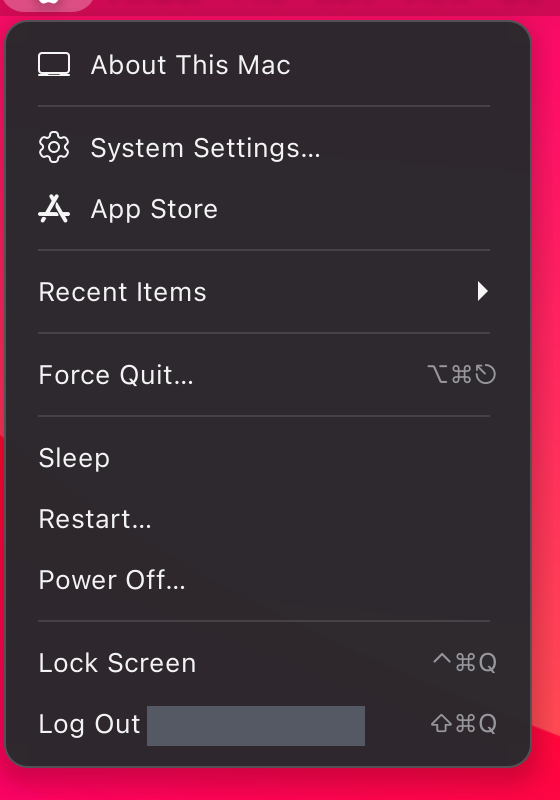](docs/screenshots/power-menu.png) | [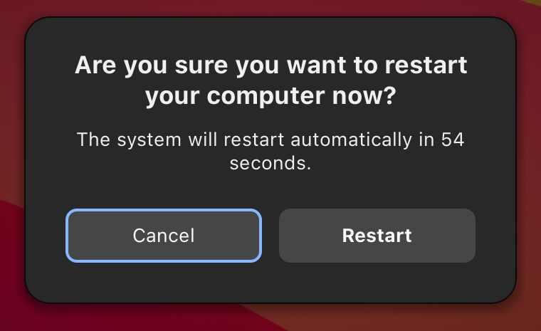](docs/screenshots/restart-dialog.png) |

**Keyboard brightness menu**

[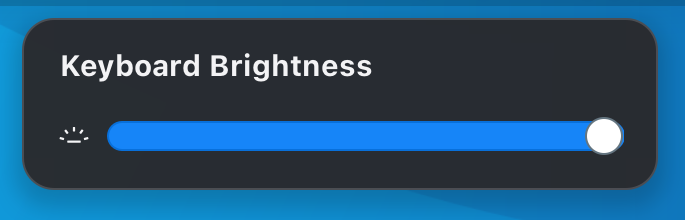](docs/screenshots/keyboard.png)

[All screenshots and capture notes](docs/SCREENSHOTS.md)

## What it includes

- A single Apple-style system menu, application menus where apps export them, and Finder-like desktop actions.
- A fixed bottom dock that reserves window space, native running dots, and separate close/quit shortcuts.
- Left-side window controls, rounded outer corners, compact menus and optional minimize animation.
- Command-key shortcuts and screenshot shortcuts that also work over supported Shell menus/dialogs.
- A vector-derived boot logo with a progress indicator; a separate, version-guarded login layout.
- Optional finger-scroll distance scaling and Chromium smooth-scroll launch flags.
- Pinned upstream source archives, local backups, rollback commands, checksums and tests.

See [the complete change inventory](docs/CHANGES.md) for scope and file locations. Some features remain experimental; [STATUS.md](STATUS.md) distinguishes tested code from visually verified behavior.

## Compatibility

| Component | Current supported baseline |
|---|---|
| Desktop integration | Zorin OS 18.x, GNOME Shell 46, Wayland; existing WhiteSur setup for desktop-only mode |
| Full hardware profile | Intel MacBookPro10,1 (15-inch Retina family); tested machine ran Zorin OS 18.1 |
| Other Macs / distributions | Not validated. Full installation intentionally refuses other hardware. Contributions for separate profiles are welcome. |
| App global menus | Apps exporting compatible D-Bus menus; not every Linux application |
| ChatGPT patches | Optional, exact-source guarded; unsupported app versions stop rather than patch blindly |

The project name is distribution-independent. The first implementation is not: it uses Zorin's dock, GDM theme packaging and GNOME 46 internals. Removing those checks does not make it portable.

## Start here

```bash
git clone https://github.com/kilinccagatay/familiarmac.git
cd familiarmac
./install.sh --check
./install.sh --full --dry-run
```

Read the [installation guide](docs/INSTALL.md), then on the supported machine:

```bash
./install.sh --full
```

No automatic logout or reboot. Full installation changes keyboard mapping, system themes, boot and login presentation and requires `sudo`. Touchpad preferences, Wi-Fi repair, scroll scaling and application patches are **opt-in**.

To add our current scroll/menu options on a supported fresh install:

```bash
./install.sh --full --scroll --smooth --brave --brightness
```

Do not run a downloaded script through `curl | sudo bash`. Clone, inspect the plan, keep your backups and use the supported baseline. This installation path has preflight/unit/integration tests; a clean-OS end-to-end install has **not yet been independently verified**.

## Reinstall and undo

Keep a copy of the repository/release and your own files outside the machine before formatting. The source archives in `vendor/` are pinned; distro packages still require network access. Local rollback backups are stored under `~/.local/state/macbook-zorin` and `/var/lib/macbook-zorin`, not in GitHub. Those names are retained for compatibility with existing installs.

```bash
./restore.sh             # user profile and optional user components
./restore.sh --system    # also restore managed boot/login/keyboard/app patches
```

Read [rollback details and limitations](docs/INSTALL.md#rollback) first. Rollback retains installed packages and extension source files; it is not an OS snapshot or an uninstaller for third-party software.

## Development

```bash
NODE=node bash tests/run.sh
```

The tests run without changing your desktop. D-Bus integration and GDM-source tests are documented separately in [DEVELOPMENT.md](docs/DEVELOPMENT.md). Please include your GNOME version, session type, hardware model and the affected component when reporting a bug; do not upload account tokens or personal logs unredacted.

## Credits and licensing

Built on keyd, WhiteSur, AppMenu, Rounded Window Corners, Touchpad Gesture Customization, Magic Lamp, GNOME and libinput. See [THIRD_PARTY.md](THIRD_PARTY.md) for exact versions, licenses, source URLs and our modifications; checksums are in [vendor/SHA256SUMS](vendor/SHA256SUMS).

Project-authored integration code is GPL-3.0-or-later. Third-party code/assets retain their original licenses and notices; see [LICENSE](LICENSE). Apple, macOS, MacBook and the Apple logo are Apple trademarks. Names and visual references describe the compatibility goal and do not imply affiliation or endorsement. No macOS system binaries, account credentials or user photos are included.
