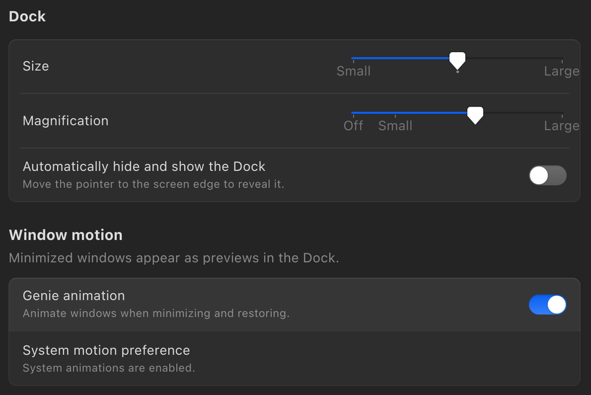
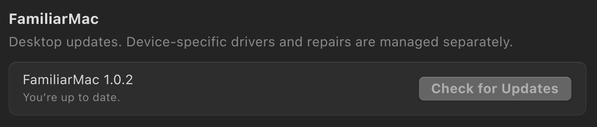
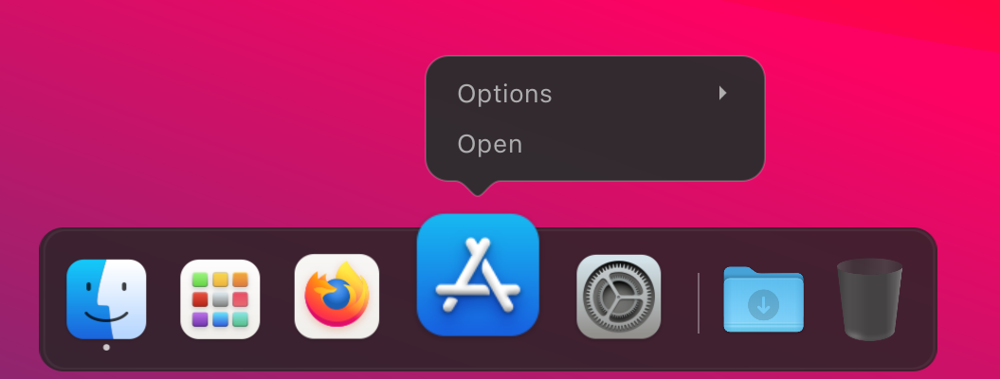

# Dock & Window

The normal desktop installer adds **Dock & Window** to Settings’ left sidebar, immediately after Appearance.
It includes the Genie switch, the existing system motion preference (read-only),
and a Configure Applications entry that opens a separate application picker. When system animations are disabled, the Genie switch displays off. Turning it
on asks permission to enable system animations as well; Cancel changes neither
setting. If system animations are already enabled, Genie switches immediately.
No separate Reduce Motion setting is created.

**Animate opening applications** makes launching Dock icons bounce until a mapped
application window is ready. It is enabled by default, respects the system animation
preference, and stops after 15 seconds if no window appears. It changes visual
feedback only; application startup state and launch completion remain unchanged.

**Check menus** invokes the same `RealMenuManager` discovery implementation used
by the top panel, for one running application's window. It does not launch or quit
applications, activate menu commands, rewrite profiles or apply global adapters.
Open the application's main window first. An independent, short-lived reader
queries the current exported menu and public actions, counts menu items and
shortcut hints, then releases its subscriptions. Concurrent checks are rejected.
Existing application installers and deferred-profile watchers continue unchanged.

- **Not checked:** no recorded live inspection.
- **Configured:** the existing configuration scanner recorded an applied setup;
  this does not prove live menu export.
- **Adapted:** menu items were detected at the recorded time. Missing shortcut
  hints or commands can still require work; this is not a visual certification.
- A closed app, absent exporter or unavailable panel service gets an explicit
  message, not a success badge.

Results stay in `~/.local/state/familiarmac/menu-inspections/`. They contain
application IDs, counts and timestamps, not window titles or document contents.
The application inventory refreshes whenever the picker opens or the user returns to it. Settings itself does not enumerate apps.

## Installation and boundaries

The sidebar uses a user-local GTK resource overlay and a small compiled helper
that calls public GTK/Adwaita APIs. No system package file is replaced. The
Settings binary hash gates both the existing About overlay and this integration;
a changed package falls back to native Settings until reinstallation. Unsupported
sidebar templates or missing build dependencies retain native Settings. Normal
preparation already supplies the C compiler. About restore removes the helper,
sidebar resources and wrapper together and restores prior launchers.

Runtime visual tests use a private session **and system bus**, so test clicks
cannot operate host network/power services.

The helper is loaded only by the Settings wrapper and removes its preload from
the environment before child applications are launched. Native pages and their
objects remain intact. New top-panel JavaScript requires a normal new login;
Settings itself must be reopened to load the sidebar. No boot, Wi-Fi, graphics,
firmware, driver or host-specific tuning is installed by this feature.

Validation: isolated real GTK Settings session exercised sidebar navigation,
return to native pages, unavailable-service feedback and normal close. Unit tests
cover selected-app discovery, empty/closed/busy states, cancellation, shortcut
counts, result persistence and lazy application enumeration. Clean-desktop sandbox checks install
and reapply while preserving system motion and host hardware configuration.

After Check menus reports that an unadapted app is not running, an Open app button appears beside it. It launches the installed desktop entry; check again once the app is ready. Successful adaptation hides the button. Previously adapted apps do not show it, and reopening the checker resets its visibility.

## Guided menu setup

Dock & Window shows a single Configure Applications entry; installed apps are enumerated only when its separate picker opens. Search the list, select an app to launch it, and use Check menus after its main window is ready. The compact checker is non-modal and requests keep-above through GTK3/XWayland. Its backend setting is restored before launching the selected app. Back returns to the picker and removes keep-above. Closing the checker leaves the selected application running. Adapted status still means exported menu items were detected, not that every command was manually verified.

After a missing-menu or closed-window result, users may choose **No menu needed** or **Needs support**. These are user classifications, not automatic compatibility conclusions. They preserve the last inspection as evidence and never disable an app or its menu bridge. Closed transient launchers such as FamiliarMac Apps can be classified too. A later successful live check replaces the classification with Adapted; service failures do not offer these choices.

GTK applications can export only an application menu without a File/Edit menu bar. The reader now includes that native GMenu tree. When window GTK addresses are missing, discovery matches an already-running GtkApplication bus to the window PID, pins its unique bus owner and validates interfaces before reading. It never activates services or borrows another process’s actions. Existing DBusMenu and native menu-bar backends retain priority.

After successful adaptation, setup requests a normal close of the inspected window only if setup launched the previously stopped app. Preexisting applications, failed checks, expired launch tickets and apps restarted outside setup are left alone. Closing uses the window manager’s normal close request, so unsaved-work prompts are preserved; no process is killed. This tracking requires the updated panel service in a new login. Older sessions can still launch and check apps without automatic closing.

## Dock ordering

Finder and Apps occupy the first two positions and cannot be dragged or unpinned. Other favorites keep their relative order. Reordering uses actual visible icon centers and a visible, icon-sized insertion slot; native Dash still handles the drop commit and cancellation. The reserved positions cannot be used as insertion targets. File-to-Trash handling is unchanged.

Fixed launcher drag suppression intercepts the pre-drag threshold path as well as explicit starts: blocking only `startDrag` leaves GNOME's subsequent actor update without a drag actor. The insertion target remains stable while the pointer is inside its expanded placeholder. Regression tests cover pre-drag suppression, cleanup and this gap transition.

During reordering, neighboring icon contents ease across native layout changes in 160 ms, including the gap closing after cancellation. Hit boxes and insertion calculations stay in their actual layout positions, preventing feedback between animation and target selection. System-disabled animations skip this easing. No favorites are committed until drop.

## Network status menu

The panel follows GNOME's primary-connection indicator: Ethernet remains visible when it owns the primary route, while the same menu keeps Wi-Fi controls. The Ethernet row identifies that connection and interface. Visible Wi-Fi networks are grouped using their actual saved NetworkManager profiles into Known Networks and expandable Other Networks; activation and authentication use GNOME's native network model. Network Settings and Wi-Fi Settings are both available. The menu does not change connection priorities or fabricate Apple-specific hotspot battery/cellular telemetry.

Dock reordering collapses the original icon container only after GNOME has built the floating drag actor. The insertion gap is transparent and matches the source container width (including icon padding); no faded duplicate or blue selector is shown. Drop positions are calculated among the remaining favorites. Cancel/end restores the original container, and favorites change only after an accepted drop.

Dragging a favorite more than 64 logical pixels above its original dock position offers “Remove from Dock” on the dock's background drop target. Returning to the dock or cancelling clears the hint; only dropping removes the favorite. Running apps may still be shown as running, and application files are never deleted. Finder/Apps remain protected. This follows [Apple's documented Remove-before-release interaction](https://support.apple.com/en-jo/guide/mac-help/mh35859/mac); Apple does not specify a numeric threshold there.

Wi-Fi rows show a circular signal badge: blue for the active network and neutral for others, without a checkmark. The connected state remains in the accessible label. The primary connected Ethernet indicator uses an original bracket-and-three-dots symbolic SVG; native disconnected/acquiring/error icons remain unchanged. Both color schemes are supported.

The Wi-Fi heading is a non-interactive row. Only the switch is clickable/focusable and changes radio state; the heading/row has no selected or hover background. Keyboard activation remains available on the switch, and the hardware radio block is respected.

## Size, magnification and auto-hide (1.0.1)

Size uses Small–Large endpoints; the 50% stop restores the original 48-pixel icon setting. Magnification uses Off–Small–Large with a stop at Small. Hover expands neighboring icons and the background; the divider follows the section boundary and labels stay above the icons. Auto-hide uses edge entry without pressure, zero additional show delay, a 280 ms transition and 150 ms hide delay. Magnification participates in reveal but cannot activate for a hidden Dock. A monitor-anchored vertical hover lane includes the space above and below icons.

Shell JavaScript changes require a new login. Open GTK applications may need restarting to pick up shared theme changes. User-specific NVIDIA, firmware, Wi-Fi and boot repairs are not part of these desktop controls.

## Installed desktop screenshots (1.0.2)

Captured on the reference Mac on 18 November 2026. See the [gallery](SCREENSHOTS.md) for capture details.
