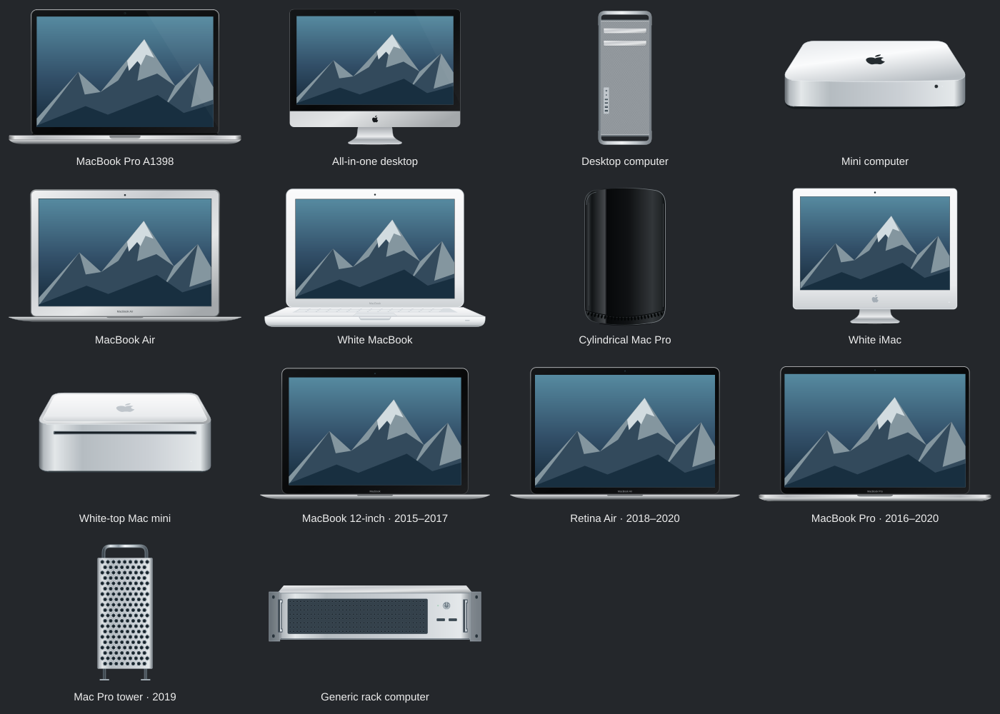
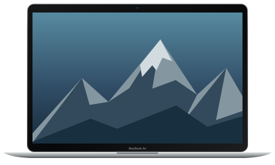
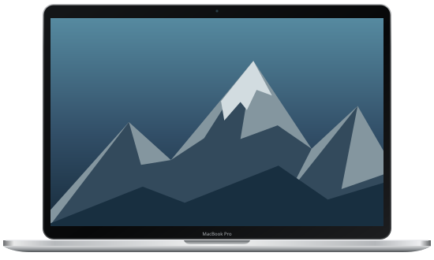
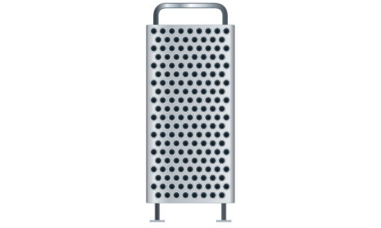
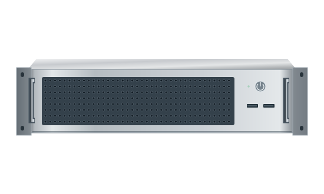
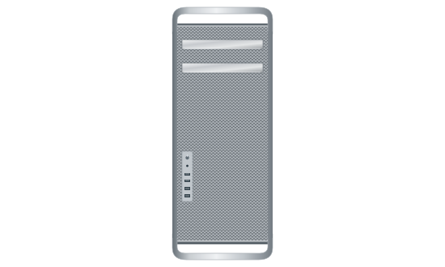
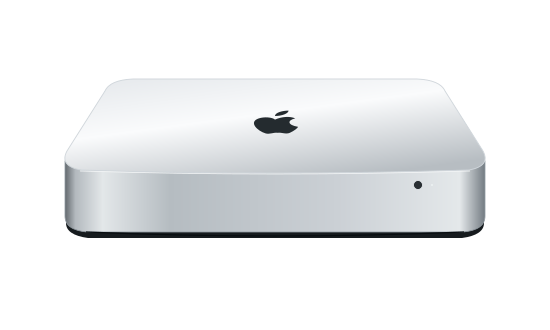
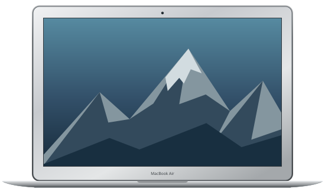
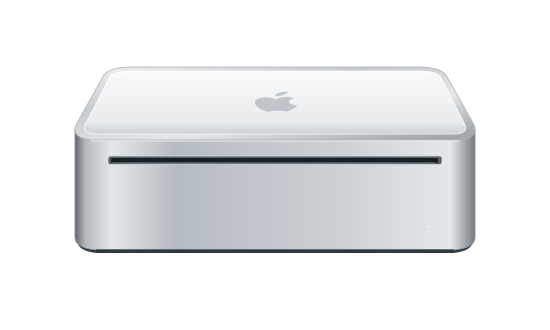
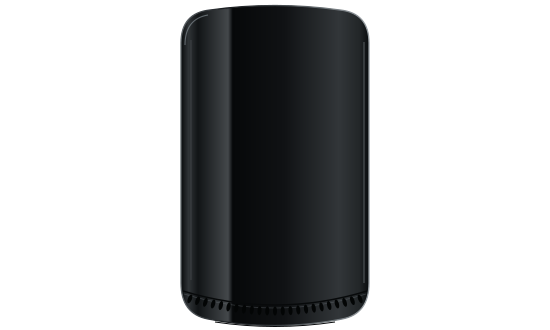

# Hardware category illustrations

Fourteen original SVG illustrations share the existing A1398 drawing’s palette, metallic gradients, geometric mountain wallpaper and transparent background. No generated raster or product photos are installed. The MacBook Pro illustration is the exact original `macbook-pro-a1398.svg` shown in the repository About screenshot.

| Category | Artwork |
|---|---|
| 12-inch Retina MacBook |  |
| Retina MacBook Air |  |
| 2016–2020 Intel MacBook Pro |  |
| 2019 Mac Pro tower |  |
| Generic rack |  |
| Laptop |  |
| All-in-one desktop |  |
| Desktop computer |  |
| Mini computer |  |
| MacBook Air |  |
| White MacBook |  |
| White iMac |  |
| White-top Mac mini |  |
| Cylindrical Mac Pro |  |

Selection is offline, by Apple model family or chassis type. MacPro6,1 selects the cylinder. MacBook1–7 identifiers select the representative white polycarbonate category except the aluminum MacBook5,1. Actual colour is not inferred from DMI; some early models also came in black. MacBook Air has its own category. Unknown desktops retain the tower fallback. The mini illustration has no optical drive slot.

These are category illustrations, not exact-model or hardware-compatibility claims.

## Reference designs and scope

The six category drawings were redrawn from historical Apple product photographs:
13-inch MacBook Air (Mid 2013), white unibody MacBook (Mid 2010),
27-inch iMac (Late 2013), aluminum Mac Pro (2010–2012), cylindrical Mac Pro
(Late 2013), and Mac mini (Late 2012, no optical drive). The A1398 MacBook Pro
asset remains byte-for-byte unchanged. SVG backgrounds are transparent in both themes.

The installer selects the illustration from the **target computer**, offline, each time
`install-about.py` runs; no author-machine model is stored as an installation default.
This only selects artwork and never installs graphics drivers or boot configuration.

These remain family illustrations. Visually distinct families not yet drawn separately
include black polycarbonate MacBooks (colour cannot be inferred reliably from their model ID),
and some earlier non-unibody laptop enclosures. Earlier PowerPC designs such as the iMac G3/G4,
iBook clamshell and Power Mac G4 Cube also need their own artwork to depict them
accurately; a generic fallback does not imply that the current Zorin installer supports
those architectures. No new category is silently claimed as an exact match.

References: [MacBook Air](https://support.apple.com/en-us/102869),
[MacBook](https://support.apple.com/en-us/103257),
[iMac](https://support.apple.com/en-us/108054),
[Mac mini](https://support.apple.com/en-us/102852),
[Mac Pro](https://support.apple.com/en-us/102887).

## White legacy enclosures

White iMac artwork selects iMac4,1 / 4,2 / 5,1 / 5,2 / 6,1 (2006) and
the similar G5 enclosures PowerMac8,1 / 8,2 / 12,1. Aluminum iMac7,1 and later
retain the silver all-in-one category. The drawing represents the family, not each screen size.

White-top Mac mini artwork selects Macmini1,1 / 2,1 / 3,1 (2006–2009) and
PowerMac10,1 / 10,2 (2005). It depicts the common optical-drive front; the 2009
server variant shares an identifier but has no optical slot. Macmini4,1 and later
retain the low-profile silver mini artwork. As before, PowerPC artwork matching
does not imply installer/OS compatibility. Driver and boot policies are unaffected.

## Later Intel families and rack chassis

- MacBook8,1 / 9,1 / 10,1: 12-inch Retina MacBook (2015–2017).
- MacBookAir8,1 / 8,2 / 9,1: Retina Air (2018–2020 Intel).
- MacBookPro13–16: representative 2016–2020 Intel Pro front view; 13/15/16-inch sizes share the category. Earlier Retina Pro retains the original A1398 art.
- MacPro7,1: 2019 tower unless chassis type is rack.
- SMBIOS chassis type 23 (Rack Mount Chassis) takes precedence, including on non-Apple devices. Xserve models also select the generic rack drawing.

The 2019 Mac Pro tower and rack share MacPro7,1. When firmware omits reliable rack chassis information the selector defaults to tower; model ID alone cannot distinguish them. Generic rack artwork is representative, not an exact Apple rack enclosure.

These are presentation mappings only; no new architecture, driver, or boot support is installed. Apple Silicon generations are not added to these Intel mappings.

References: [Apple Mac Pro identifiers](https://support.apple.com/en-gb/102887) and [dmidecode chassis types](https://github.com/mirror/dmidecode/blob/master/dmidecode.c).
