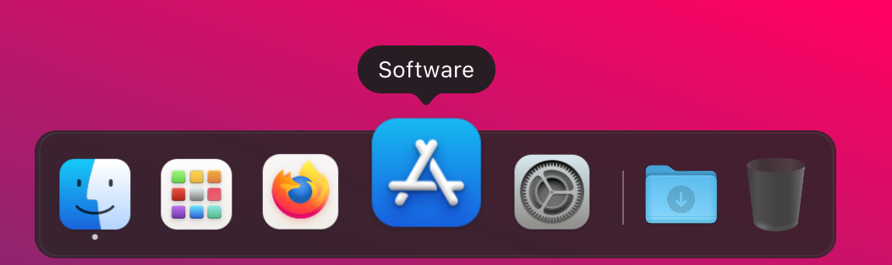
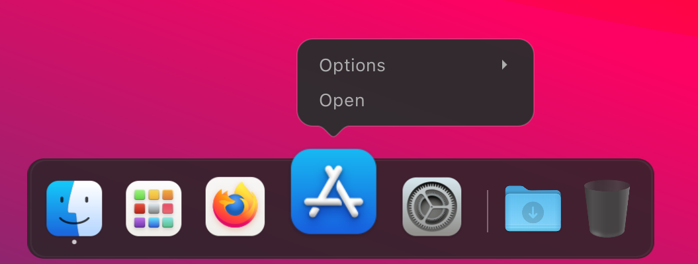
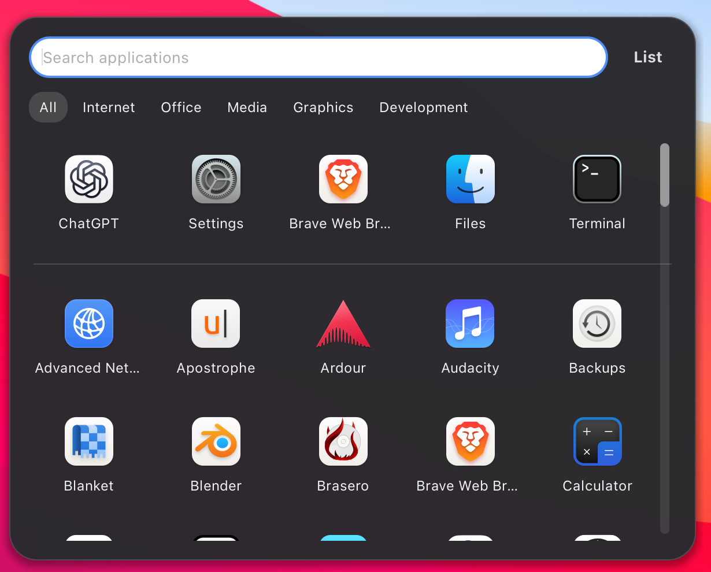
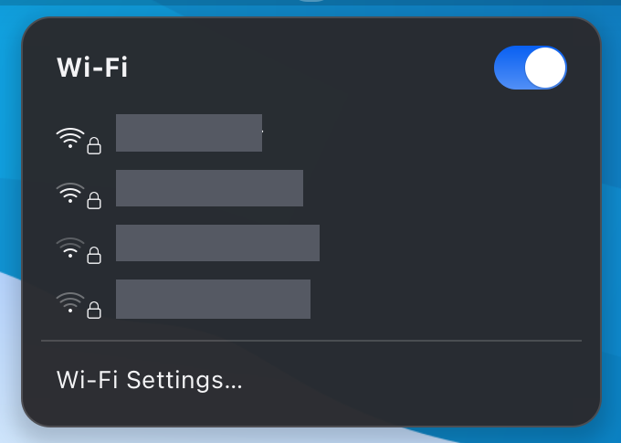
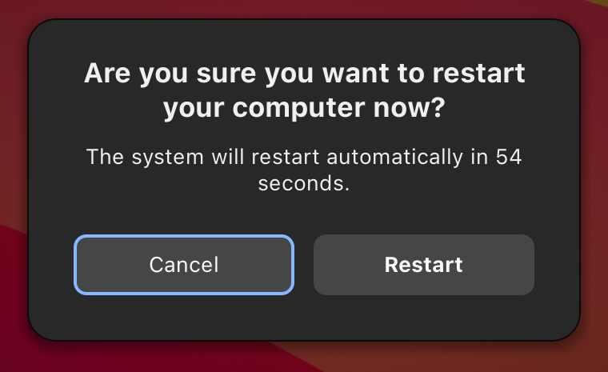
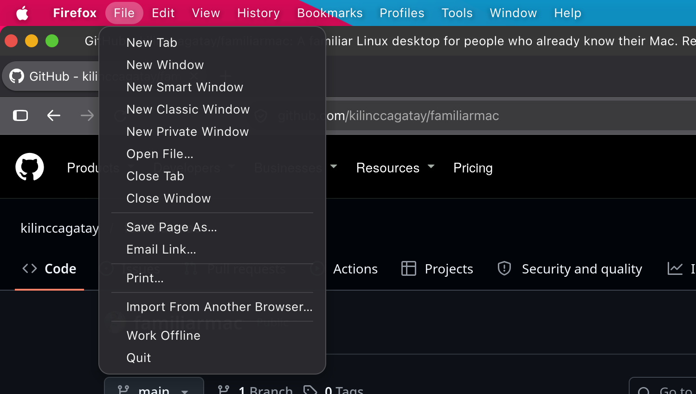
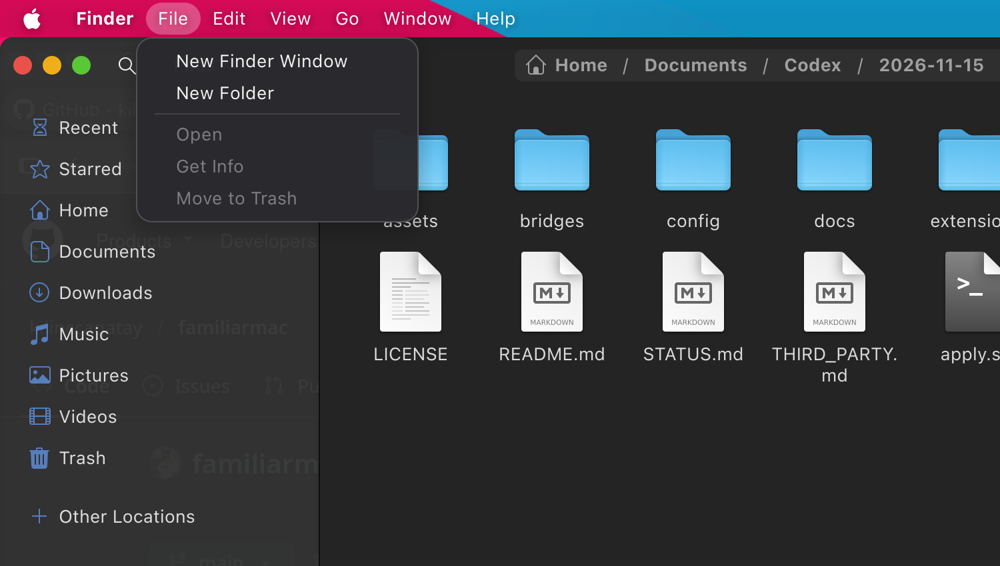
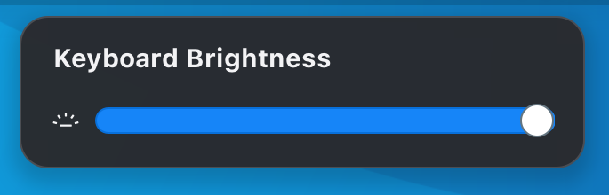
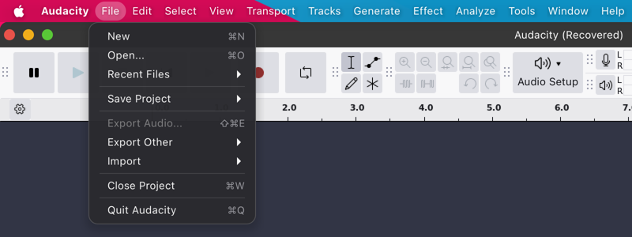
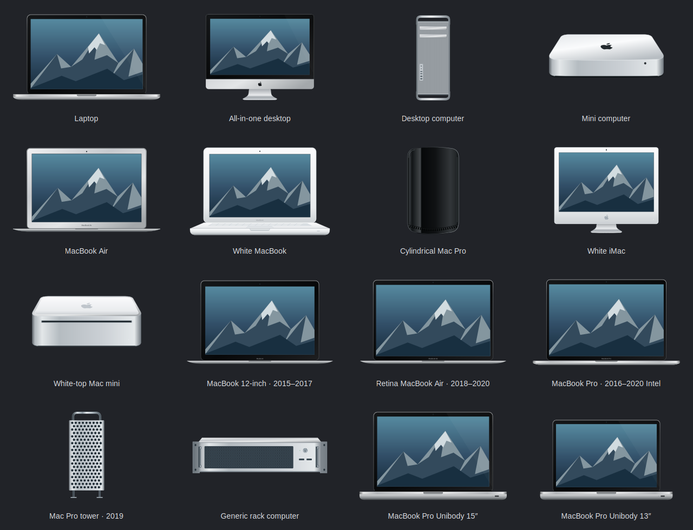

# FamiliarMac

**Mac kullanımına alışmış insanlar için tanıdık bir Linux deneyimi.**

[English](../README.md) · [Kurulum](INSTALL.md) · [Tüm değişiklikler](CHANGES.md) · [Kaynaklar](../THIRD_PARTY.md) · [Cihaza özel kayıtlar](machines/README.md)

Apple'ın işletim sistemi desteği sona erdiğinde bir MacBook hâlâ kullanılabilir durumda olabilir. Linux bu bilgisayara yeni bir ömür kazandırır. Ben de masaüstünde alışılmış kullanım biçimini korumak istedim.

Bu proje, babamın MacBook'una Linux kurduğumda onun alışkanlıklarını değiştirmesini istemememle başladı. macOS kullanırken bildiği günlük işlemleri Linux'ta da tanıdık bir şekilde yapabilmesini hedefledim. Amacım Linux'u macOS yapmak değil; günlük kullanım deneyimini mümkün olduğunca tanıdık hale getirmek. Tema, kısayollar, menüler ve düzeltmeler hem başkalarının kullanabilmesi hem de kendi bilgisayarıma format attığımda tekrar kurabilmem için bu depoda toplanıyor.

## Son sürüm: 1.2.12

[Sürüm notları](releases/v1.2.12.md) · [İndir](https://github.com/kilinccagatay/familiarmac/releases/tag/v1.2.12)

Apps görünümü Tahoe oranlarına göre düzenlendi; Grid/List seçimi hatırlanır, kaydırma ve ayırıcı çizgiler tutarlı davranır. Ek [Mac tarzı klavye kısayolları](MAC-KEYBOARD.md) ve köşe çizimi performans iyileştirmeleri eklendi.

Ayarlar’daki **Dock & Window** bölümünden Dock boyutunu, büyütmeyi, otomatik
gizlemeyi ve pencere animasyonlarını düzenleyebilir; uygulama menülerini
uyarlayabilir ve FamiliarMac güncellemelerini kontrol edebilirsiniz.

Makineye özgü NVIDIA/Nouveau, Wi-Fi onarımları ve çekirdek/açılış ayarları
otomatik kuruluma dahil değildir. Güncelleme adımları ve ayrıntılı değişiklikler
sürüm notlarında yer alır.

Mission Control, adlandırılmış masaüstlerini, tam ekran uygulama alanlarını ve parmağı izleyen masaüstü geçişlerini destekler. Klavye ve fare kısayolları Dock & Window’dan ayarlanır. Magic Mouse bağlandığında Mouse ayarlarında hareket demoları, sayfa geçişi ve belge yakınlaştırma seçenekleri görünür. Bluetooth menüsü cihaz pillerini gösterir; Bluetooth ve Wi-Fi simgelerinin görünürlüğü kendi sistem ayarlarından yönetilir. [Hareketlerin davranışı ve sınırları](MISSION-CONTROL-INPUT.md). Finder birleşik araç çubuğu, genişleyen arama alanı ve arama kapsamı tercihi sunar. [Finder ve Spaces ayrıntıları](FINDER-AND-SPACES.md).

## Ekran görüntüleri

Kurulu masaüstünden alınan görüntülerin özelliklere odaklanan kırpılmış bölümleri. Tam görüntüyü açmak için görsele tıklayabilirsin. Ağ ve hesap adları gerektiğinde gizlenmiştir.

[](screenshots/dock-magnification.png)

**Dock & Window**

[](screenshots/dock-window.png)

[](screenshots/dock-window.png)

[](screenshots/dock-context-menu.png)

| Bu Mac Hakkında | Uygulamalar |
| --- | --- |
| [](screenshots/about.png) | [](screenshots/apps.png) |

| Spotlight araması | Hesap makinesi |
| --- | --- |
| [](screenshots/spotlight-search.png) | [](screenshots/spotlight-calculator.png) |

| Denetim Merkezi | Bildirim Merkezi |
| --- | --- |
| [](screenshots/control-center.png) | [](screenshots/notifications.png) |

| Wi-Fi | Ses |
| --- | --- |
| [](screenshots/wifi.png) | [](screenshots/sound.png) |

| Ekran parlaklığı | Ses göstergesi | Klavye ışığı |
| --- | --- | --- |
| [](screenshots/brightness-osd.png) | [](screenshots/sound-osd.png) | [](screenshots/keyboard-osd.png) |

| Sistem ve güç menüsü | Yeniden başlatma onayı |
| --- | --- |
| [](screenshots/power-menu.png) | [](screenshots/restart-dialog.png) |

**Uygulama menüleri üst çubukta**

Üst menü çubuğu etkin uygulamaya göre değişir. Firefox ve Finder adıyla gösterilen Dosyalar uygulaması, File menüleri açıkken çekilmiştir.

| Firefox | Finder |
| --- | --- |
| [](screenshots/firefox-global-menu.png) | [](screenshots/finder-global-menu.png) |

**Giriş ekranı**

[](screenshots/login.png)

**Klavye parlaklığı menüsü**

[](screenshots/keyboard.png)

[Tüm ekran görüntüleri ve açıklamalar](SCREENSHOTS.md)

## Mevcut destek

İlk profil **Zorin OS 18.x / GNOME 46 / Wayland** içindir. Tam donanım kurulumu **MacBookPro10,1** ile sınırlandırılmıştır. Projenin adı herhangi bir dağıtıma bağlı değildir; fakat mevcut kodun başka dağıtımlarda çalıştığı iddia edilmez. Genel `--all` kurulumu bu donanım profilini uygulamaz; desteklenen Zorin tabanını gerektirir. Ubuntu/Fedora ve farklı fiziksel donanımlar için doğrulama ayrıca gerekir.

## Kurulum

Normal Zorin 18.x / GNOME 46 / x86_64 Wayland oturumunda:

```bash
git clone https://github.com/kilinccagatay/familiarmac.git
cd familiarmac
./install.sh --all --dry-run
./install.sh --all
```

Tek komut bağımlılıkları, tema ve simgeleri, masaüstünü, Dock'u, uygulama uyarlama
izleyicisini, cihaza göre seçilen Hakkında çizimini, Apple açılış logosunu ve giriş
ekranını kurar. Komutu normal kullanıcınla çalıştır; gerektiğinde yönetici parolası
istenir. Kurulum sonunda çalışmalarını kaydedip kendin yeniden başlat.

NVIDIA/Nouveau sürücüsü veya firmware onarımı, Wi-Fi onarımı, GRUB parametreleri,
kernel seçimi, keyd, gmux ve bu bilgisayara özgü touchpad ölçeklemesi **dahil değildir**.
Açılış görselleri için initramfs yeniden oluşturulur. `--full`, ayrı ve yalnızca
MacBookPro10,1 için olan eski donanım profilidir; genel kurulum için kullanılmaz.
`--all` donanıma özel seçeneklerle veya başka bir kurulum modu ile birleştirilemez.

Yalnızca masaüstü için `--prepare-desktop` ardından `--desktop`; hazırlanmış
sistemde yalnızca boot/login için `--system-appearance` kullanılabilir.
Genel kurulumu geri almak için `./restore.sh --all` çalıştırılır. Dağıtım paketleri
ve ortak tema dosyaları kaldırılmaz; kişisel belgeler silinmez.

[Kurulum ve geri alma](INSTALL.md), [gerçek VM bulguları](VM-VALIDATION.md) ve
[kalan eksikler](../STATUS.md) ayrıntıları içerir. Bileşenler temiz Zorin Pro VM'de
sınandı; bu, her Mac/GPU veya ayrı bir Core kurulumunun doğrulandığı anlamına gelmez.
Desteklenen uygulamaların uyarlaması otomatiktir; her uygulamanın menü dışa aktarma
özelliği olduğu iddia edilmez. Açık uygulamaların tamamen yeniden açılması gerekebilir.

Yerel yedekler kullanıcı durum klasöründe ve `/var/lib/macbook-zorin` ile
`/var/lib/familiarmac/system-appearance` altında tutulur; GitHub'a gönderilmez.
Format öncesi kişisel dosyalarını ayrıca yedekle.

## Otomatik uygulama uyarlaması

Kurulum ve güncelleme olayları, sürekli tarama yerine bir systemd kullanıcı
izleyicisiyle algılanır. Flatpak çalışma ortamı güncellemeleri de kontrol edilir.
GTK3/wxGTK uygulamalarının gerçek menüleri, çalışma ortamında uyumluluğu doğrulanan
modülle aktarılır; mevcut kütüphane yolları korunur. GTK4 ve Qt ayrı kurallarını
kullanmaya devam eder. Electron uygulamalarında gerçek kısayollar üst menüye aktarılır.

[](screenshots/audacity-global-menu.png)

Bu, her Linux uygulaması için destek garantisi değildir. Açık uygulamayı normal
şekilde yeniden başlatmak gerekebilir. [Teknik akış](APPLICATION-INTEGRATION.md) ve
[uygulama denetimi](APPLICATION-AUDIT.md) doğrulananları ve kalan eksikleri açıklar.


## Menü ve ortak tema güncellemelerini uygulama

Ortak GTK başlık kuralları pencere düğmelerinin boyutunu korur; düğmeler ve arama
alanları için dengeli üst-alt boşluk sağlar. Yerel GTK uygulamalarına ve desteklenen
Flatpak uygulamalarına kurulur; kurulum/güncelleme izleyicisi de aynı kaynakları kullanır.
Kısmi menüler yalnızca gerçekten dışa aktarılan, tanınan komutlarla tamamlanır.
Kısayollar uygulamanın gerçek menü verisi, tuş haritası veya açık GtkBuilder
eylem/kısayol tanımlarından okunur. Dosya seçicinin sahibi doğrulanabiliyorsa panelde
isteği yapan uygulamanın adı korunur. Dışa aktarılmayan GTK4 komutları hâlâ kapsam dışıdır.

Mevcut kurulumda, depo klasöründe normal masaüstü kullanıcınla çalıştır:

```bash
git pull --ff-only
bash install.sh --check
bash install.sh --desktop --dry-run
bash install.sh --desktop
```

Bu işlem masaüstü profilini yeniden uygular; menü eklentilerini ve ortak tema
uyarlayıcılarını kurar. İsteğe bağlı Wi-Fi ve açılış kurulumu seçilmez.
Yeni Shell kodu için çalışmalarını kaydedip oturumu kapatıp aç; GTK teması için
uygulamaları tamamen kapatıp yeniden aç. Bazı uygulamalar son pencere kapansa da
arka planda kalır. Kurulum otomatik çıkış veya yeniden başlatma yapmaz.
[Kurulum/geri alma](INSTALL.md), [teknik akış](APPLICATION-INTEGRATION.md) ve
[kalan eksikler](APPLICATION-AUDIT.md) ayrıntıları içerir.


### Başka bir eski Mac'e kurulum ve cihaz çizimleri

Desteklenen Zorin tabanında `./install.sh --all` genel kurulumun tamamını yapar.
`--check` uyumluluk raporunu, `--all --dry-run` kurulum adımlarını gösterir.
Donanıma özel onarımlar bu akışa dahil değildir.

Hakkında ekranında 16 özgün çizimden biri hedef bilgisayarın model ailesi ve kasa
türüne göre otomatik seçilir. A1398 çizimi aynen korunur. Rack kasa bilgisi yoksa
MacPro7,1 için kule kullanılır; model kimliği tek başına rack ayrımı yapamaz.

DVD sürücülü Unibody MacBook Pro ailesi için 13 ve 15 inç çizimler
model kimliğine göre seçilir; ön sağ IR alıcısı da gösterilir. 17 inç
Unibody modelleri aynı kalın kasa ailesinin temsili çizimini kullanır.



[Çizim galerisi ve model eşlemeleri](HARDWARE-CATALOG.md) · [Kurulum sınırları](PORTABILITY.md)

Desteklenen uygulamalarda ilk açılışta oluşan profiller ve uygulama kapanışına
ertelenen ayarlar artık yaşam döngüsü zamanlayıcısıyla tekrar kontrol edilir.
Açık uygulamalar otomatik kapatılmaz. Electron menülerinde geç gelen kısayollar
güncellenir; pencereye özel canlı menü önbelleği yeni pencere geçişlerini hızlandırır.

## Sürümler ve güncellemeler

[GitHub Releases](https://github.com/kilinccagatay/familiarmac/releases) üzerinden taşınabilir paketi ve `SHA256SUMS` dosyasını indirin. Sağlamasını doğrulayıp arşivi açtıktan sonra normal kullanıcınızla `./install.sh --all` çalıştırın. **Ayarlar → Dock & Window → FamiliarMac** kurulu sürümü gösterir; **Check for Updates** yeni sürümü kontrol eder. Yeni sürüm için onay ister; aynı bölümde indirme çubuğu gösterir ve ardından otomatik kurar, masaüstü tercihlerini korur ve tamamlanınca isteğe bağlı oturum kapatma sunar.

NVIDIA/Nouveau firmware, Broadcom, kernel/GRUB ve referans bilgisayara özel onarımlar otomatik kurulmaz; yalnızca ayrı ve manuel donanım işlemleridir. [Ayrıntılar](RELEASES.md).

### Dock kontrolleri (1.0.1)

Dock & Window bölümünden boyut, otomatik gizleme ve üzerine gelince büyütme ayarlanır. Varsayılan boyuta dönmek için kaydırıcıda durak bulunur. Simge taşırken komşular yer açar; yukarıya veya Çöp Kutusu üzerine bırakmak uygulamayı silmeden sabitlemesini kaldırır. Açılışta kenar basıncı gerekmez; isim balonları ve ayırıcı büyütme hareketini takip eder. Ayrıntılar: [Dock & Window](DOCK-WINDOW.md).
