# FamiliarMac

**Mac kullanımına alışmış insanlar için tanıdık bir Linux deneyimi.**

[English](../README.md) · [Kurulum](INSTALL.md) · [Tüm değişiklikler](CHANGES.md) · [Kaynaklar](../THIRD_PARTY.md)

Apple'ın işletim sistemi desteği sona erdiğinde bir MacBook hâlâ kullanılabilir durumda olabilir. Linux bu bilgisayara yeni bir ömür kazandırır; ancak macOS'a alışmış biri için ayarların ve günlük işlemlerin yer değiştirmesi zorlayıcı olabilir.

Bu proje, babamın MacBook'una Linux kurduğumda alıştığı ayarları ve işlevleri bulmakta zorlanmasıyla başladı. Amacım Linux'u macOS yapmak değil; günlük kullanım deneyimini mümkün olduğunca tanıdık hale getirmek. Tema, kısayollar, menüler ve düzeltmeler hem başkalarının kullanabilmesi hem de kendi bilgisayarıma format attığımda tekrar kurabilmem için bu depoda toplanıyor.

## Ekran görüntüleri

Kurulu masaüstünden alınan görüntülerin özelliklere odaklanan kırpılmış bölümleri. Tam görüntüyü açmak için görsele tıklayabilirsin. Ağ ve hesap adları gerektiğinde gizlenmiştir.

[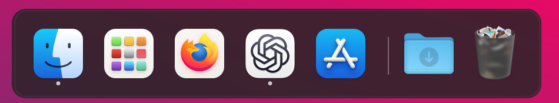](screenshots/apps.png)

| Bu Mac Hakkında | Uygulamalar |
| --- | --- |
| [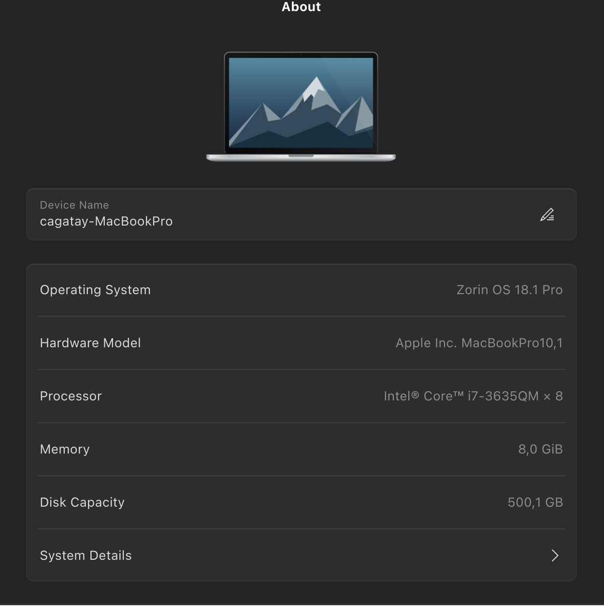](screenshots/about.png) | [](screenshots/apps.png) |

| Spotlight araması | Hesap makinesi |
| --- | --- |
| [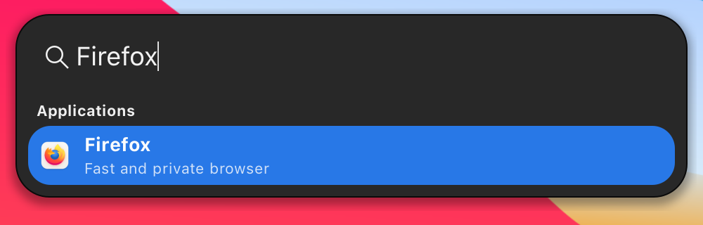](screenshots/spotlight-search.png) | [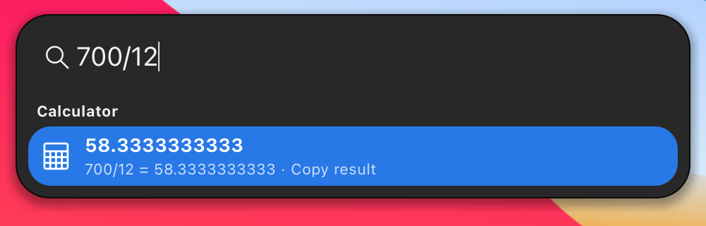](screenshots/spotlight-calculator.png) |

| Denetim Merkezi | Bildirim Merkezi |
| --- | --- |
| [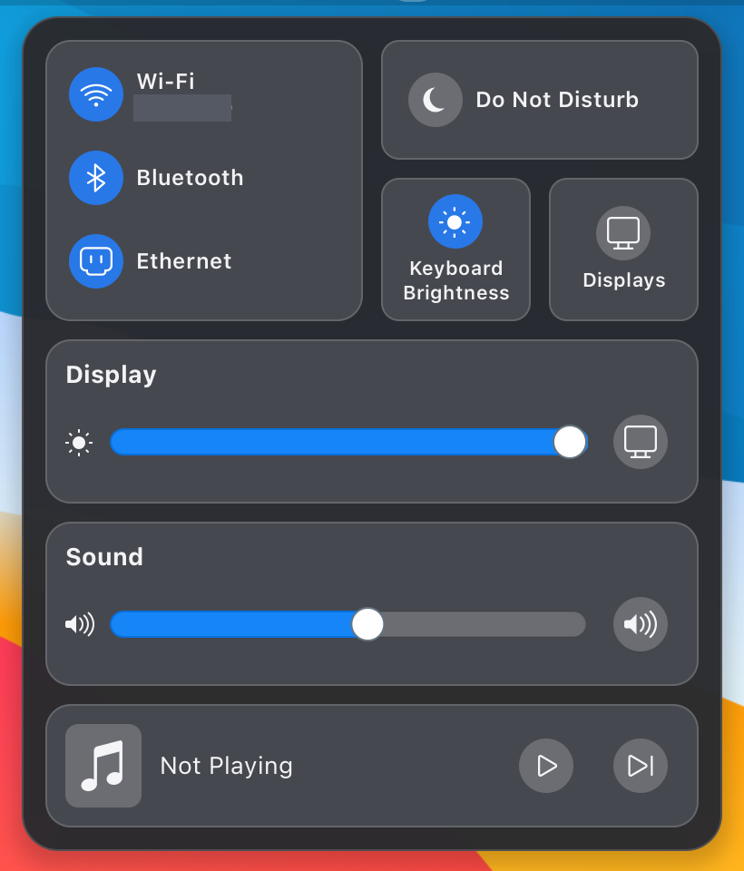](screenshots/control-center.png) | [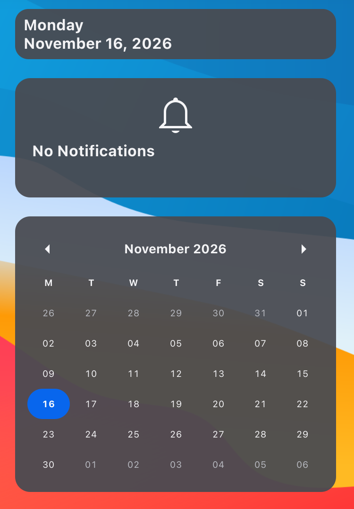](screenshots/notifications.png) |

| Wi-Fi | Ses |
| --- | --- |
| [](screenshots/wifi.png) | [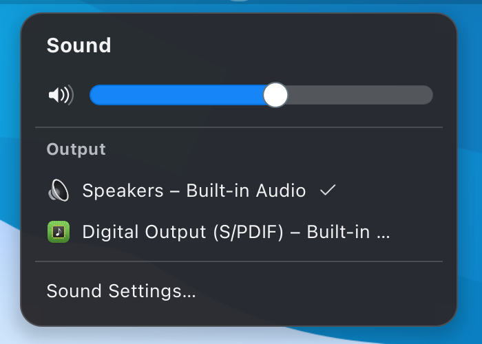](screenshots/sound.png) |

| Ekran parlaklığı | Ses göstergesi | Klavye ışığı |
| --- | --- | --- |
| [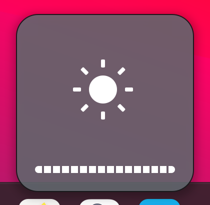](screenshots/brightness-osd.png) | [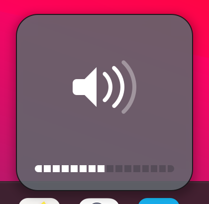](screenshots/sound-osd.png) | [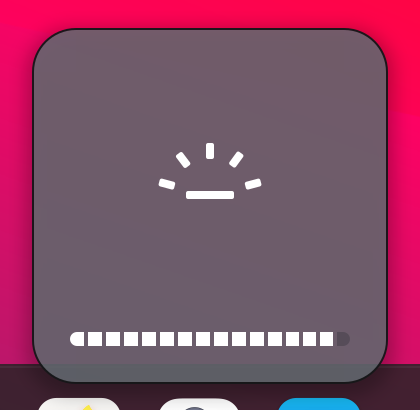](screenshots/keyboard-osd.png) |

| Sistem ve güç menüsü | Yeniden başlatma onayı |
| --- | --- |
| [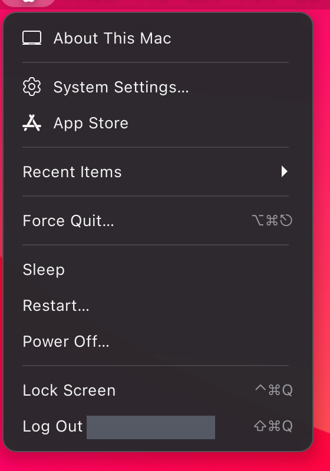](screenshots/power-menu.png) | [](screenshots/restart-dialog.png) |

**Giriş ekranı**

[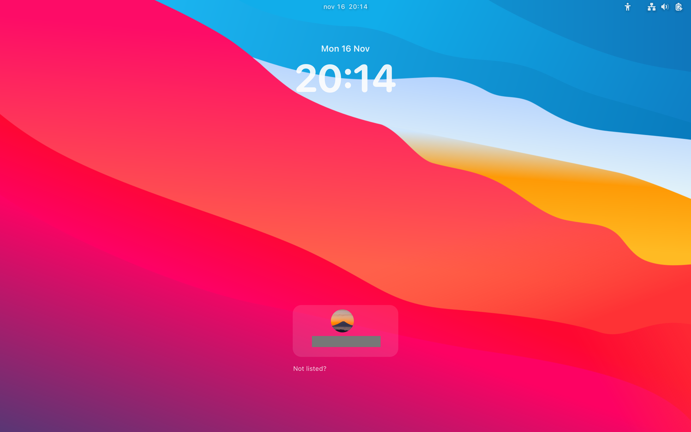](screenshots/login.png)

**Klavye parlaklığı menüsü**

[](screenshots/keyboard.png)

[Tüm ekran görüntüleri ve açıklamalar](SCREENSHOTS.md)

## Mevcut destek

İlk profil **Zorin OS 18.x / GNOME 46 / Wayland** içindir. Tam donanım kurulumu **MacBookPro10,1** ile sınırlandırılmıştır. Projenin adı herhangi bir dağıtıma bağlı değildir; fakat mevcut kodun başka dağıtımlarda çalıştığı iddia edilmez. Ubuntu/Fedora veya farklı Mac modelleri için ayrı ve test edilmiş profiller gerekir.

## Kurulum

```bash
git clone https://github.com/kilinccagatay/familiarmac.git
cd familiarmac
./install.sh --check
./install.sh --full --dry-run
# Kurulum rehberini okuyup desteklenen bilgisayarda:
./install.sh --full
```

`--full`: tema, klavye eşleme, boot/login ve masaüstü katmanını kurar. Mevcut touchpad tercihlerini korur. Kaydırma azaltma, Brave menü entegrasyonu, ChatGPT yamaları ve Wi-Fi onarımı ayrı seçeneklerdir. `--check` hiçbir ayarı değiştirmez; `--dry-run` çalıştırılacak komutları gösterir. Kurulum oturumu kapatmaz veya bilgisayarı yeniden başlatmaz.

```bash
./install.sh --full --scroll --smooth --brave --brightness
```

Bu komut tam profille birlikte parmak kaydırma mesafesini %50'ye ayarlar, kurulu Chromium uygulamalarına smooth-scroll bayrağı ekler ve Brave'i global menü için X11 üzerinden başlatır. Bu seçenek macOS'un momentum eğrisinin aynısını sağlamaz. Klavye ve pencere davranışlarının kapsamı [değişiklik listesinde](CHANGES.md) açıklanmıştır.

Ayrıntılı [kurulum/geri alma rehberi](INSTALL.md), [bilinen eksikler](../STATUS.md) ve [kaynak-lisans listesi](../THIRD_PARTY.md) yayımlanmıştır. Yeni kurulum akışı henüz boş bir işletim sisteminde uçtan uca doğrulanmadı; testlerin geçmesi bu doğrulamanın yerine geçmez.

Yerel yedekler `~/.local/state/macbook-zorin` ve `/var/lib/macbook-zorin` altındadır; GitHub'a gönderilmez. Format atmadan önce kendi dosyalarını ve tercihlerini ayrıca yedekle. Proje üçüncü taraf paketleri ve kaynaklarını geri alma sırasında kaldırmaz.

```bash
./restore.sh
./restore.sh --system
```

Apple ile bağlantılı veya Apple tarafından desteklenen bir proje değildir. Kaynaklar ve özgün lisanslar korunur.
