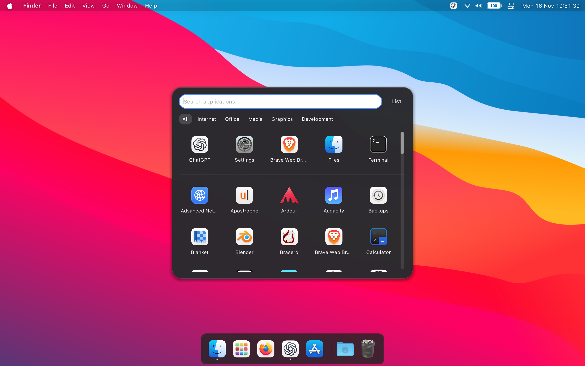
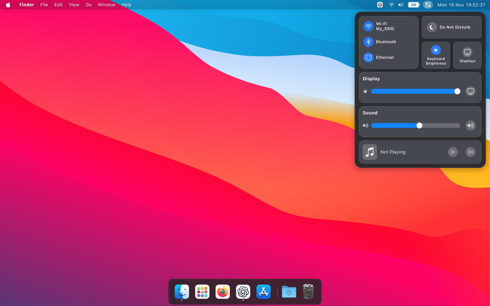

# FamiliarMac screenshots / Ekran görüntüleri

Captured on 16 November 2026 on a MacBookPro10,1 (A1398), running Zorin OS 18.1 with GNOME Shell 46. These are captures of the installed desktop, not mockups. Appearance depends on the installed theme, applications and display scaling.

16 Kasım 2026 tarihinde Zorin OS 18.1 / GNOME Shell 46 çalışan MacBookPro10,1 (A1398) üzerinden alındı. Bunlar taslak görseller değil, kurulu masaüstünün ekran görüntüleridir. Görünüm; tema, uygulamalar ve ekran ölçeklendirmesine göre değişebilir.

## About / Hakkında

The native Settings About page retains the actual operating system and hardware details. FamiliarMac supplies the MacBook illustration on supported models.

Sistemin Hakkında sayfası gerçek işletim sistemi ve donanım bilgilerini korur. FamiliarMac, desteklenen modellerde MacBook çizimini ekler.

## Spotlight search / Spotlight araması

Application search stays anchored as results appear. Command+Space opens and closes Spotlight.

Sonuçlar görünürken arama kutusunun konumu korunur. Command+Space, Spotlight’ı açıp kapatır.

## Calculator / Hesap makinesi

Basic arithmetic appears directly in Spotlight. Decimal comma and decimal point inputs are accepted; results can be copied.

Temel matematik işlemleri doğrudan Spotlight’ta sonuçlanır. Ondalık virgül ve nokta desteklenir; sonuç kopyalanabilir.

## Applications / Uygulamalar

Five-column application grid with a separate recent/frequent row, search and categories.

Ayrı son/sık kullanılanlar satırı, arama ve kategoriler içeren beş sütunlu uygulama ızgarası.

## Control Center / Denetim Merkezi

System controls follow dark/light appearance. The capture shows connectivity, Do Not Disturb, keyboard backlight, display brightness, volume and media controls.

Sistem denetimleri koyu/açık görünümü izler. Bağlantılar, Rahatsız Etmeyin, klavye ışığı, ekran parlaklığı, ses ve medya denetimleri gösterilir.

## Sources / Kaynaklar

See [sources and licenses](../THIRD_PARTY.md) for the themes, icons and other upstream components visible in these screenshots. The original A1398 vector illustration is in [assets/hardware](../assets/hardware/macbook-pro-a1398.svg). Application names and marks belong to their respective owners.

[Back to README](../README.md) · [Türkçe](README.tr.md)
