# FamiliarMac screenshots / Ekran görüntüleri

Captured on 16 November 2026 on a MacBookPro10,1 (A1398), running Zorin OS 18.1 with GNOME Shell 46. These are captures of the installed desktop, not mockups. Appearance depends on the installed theme, applications and display scaling.

16 Kasım 2026 tarihinde Zorin OS 18.1 / GNOME Shell 46 çalışan MacBookPro10,1 (A1398) üzerinden alındı. Bunlar taslak görseller değil, kurulu masaüstünün ekran görüntüleridir. Görünüm; tema, uygulamalar ve ekran ölçeklendirmesine göre değişebilir.

## About / Hakkında

The native Settings About page retains the actual operating system and hardware details. FamiliarMac supplies the MacBook illustration on supported models.

Sistemin Hakkında sayfası gerçek işletim sistemi ve donanım bilgilerini korur. FamiliarMac, desteklenen modellerde MacBook çizimini ekler.

## Application menus / Uygulama menüleri

The top menu bar follows the active application. These real captures show Firefox and Files (displayed as Finder), with their File menus open. Firefox displays the public FamiliarMac repository; Files displays its local checkout. Menu availability depends on application integration.

Üst menü çubuğu etkin uygulamayı takip eder. Gerçek çekimlerde Firefox ve Finder adıyla gösterilen Dosyalar uygulamasının File menüleri açıktır. Firefox’ta herkese açık FamiliarMac reposu, Dosyalar’da yerel repo klasörü gösterilir. Menü desteği uygulamanın entegrasyonuna bağlıdır.

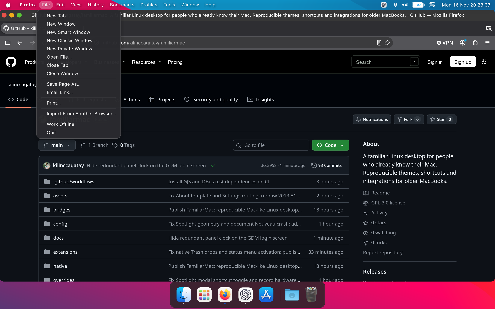

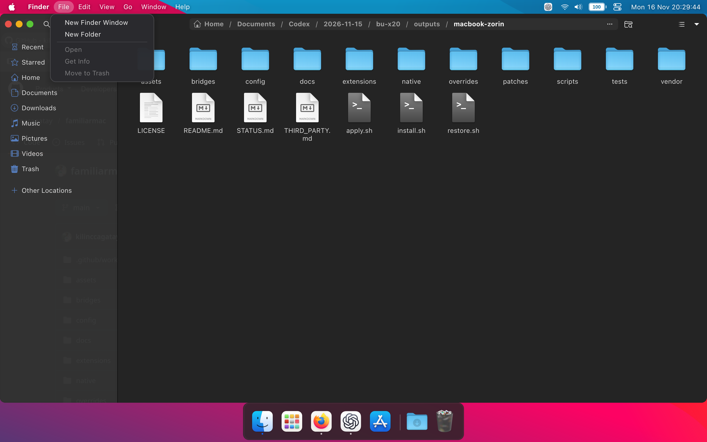

## Spotlight search / Spotlight araması

Application search stays anchored as results appear. Command+Space opens and closes Spotlight.

Sonuçlar görünürken arama kutusunun konumu korunur. Command+Space, Spotlight’ı açıp kapatır.

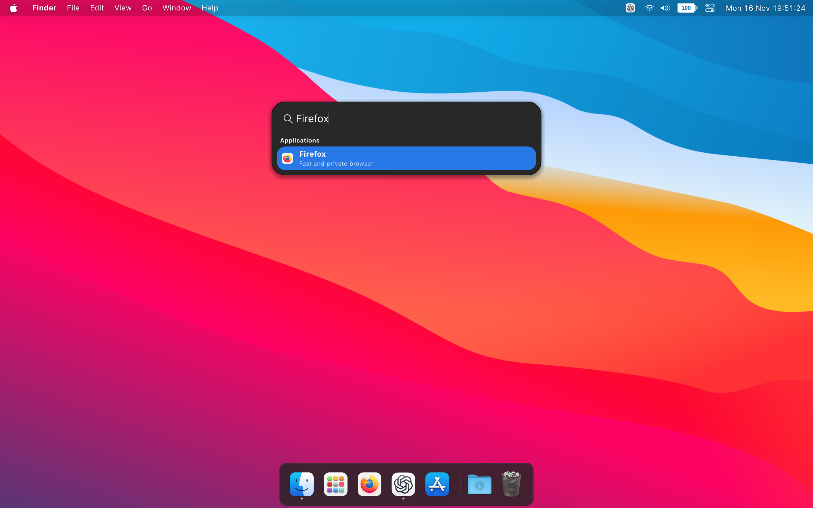

## Calculator / Hesap makinesi

Basic arithmetic appears directly in Spotlight. Decimal comma and decimal point inputs are accepted; results can be copied.

Temel matematik işlemleri doğrudan Spotlight’ta sonuçlanır. Ondalık virgül ve nokta desteklenir; sonuç kopyalanabilir.

## Applications / Uygulamalar

Five-column application grid with a separate recent/frequent row, search and categories.

Ayrı son/sık kullanılanlar satırı, arama ve kategoriler içeren beş sütunlu uygulama ızgarası.

## Control Center / Denetim Merkezi

System controls follow dark/light appearance. The network name is redacted. The capture shows connectivity, Do Not Disturb, keyboard backlight, display brightness, volume and media controls.

Sistem denetimleri koyu/açık görünümü izler. Bağlantılar, Rahatsız Etmeyin, klavye ışığı, ekran parlaklığı, ses ve medya denetimleri gösterilir.

## Wi-Fi and sound / Wi-Fi ve ses

Network selection and audio output controls. Network names are covered in the published image for privacy; the menu itself is unchanged.

Ağ seçimi ve ses çıkışı denetimleri. Yayımlanan görüntüde ağ adları gizlilik için kapatılmıştır; menünün kendisi değiştirilmemiştir.

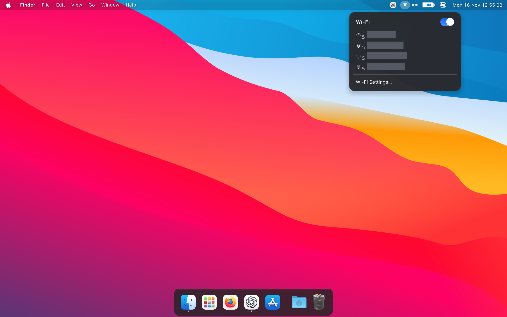

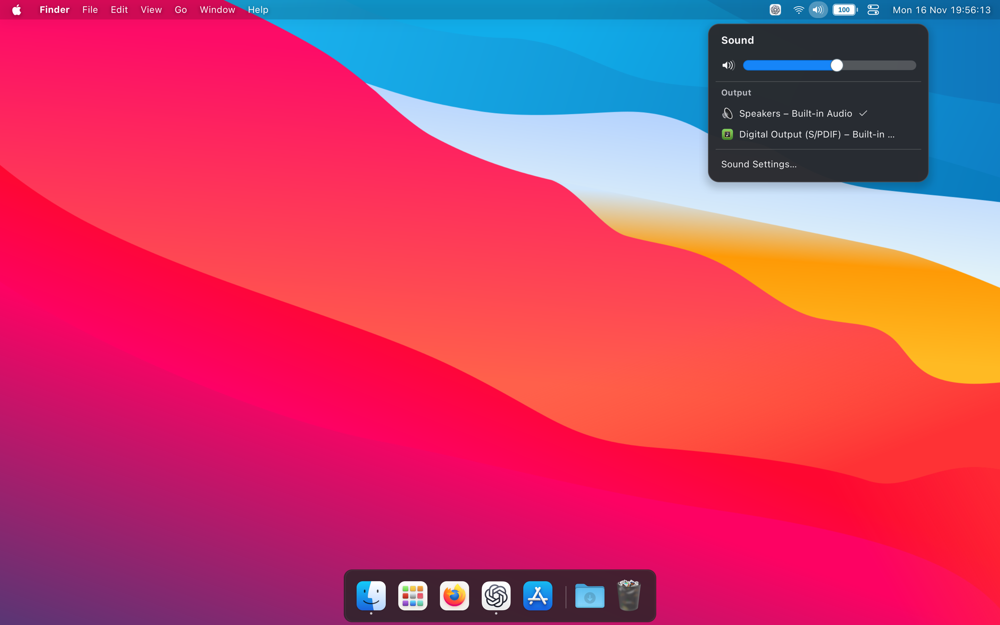

## Keyboard brightness / Klavye parlaklığı

A compact detail view using the native hardware control, without the old nested toggle/submenu layout.

Eski iç içe menü düzeni yerine, donanımın kendi kontrolünü kullanan sade klavye parlaklığı görünümü.

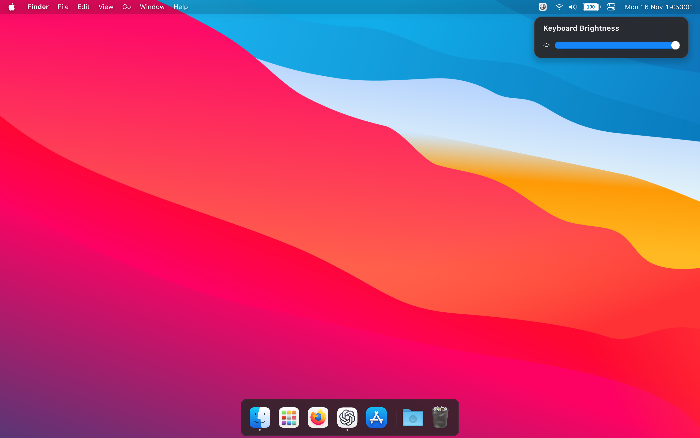

## On-screen indicators / Ekran göstergeleri

Actual display brightness, volume and keyboard-backlight indicators. These captures are cropped below the top menu bar; the indicator position relative to the Dock is retained. Original audio/backlight levels were restored after capture.

Gerçek ekran parlaklığı, ses ve klavye ışığı göstergeleri. Görüntüler üst menü çubuğunun altından kırpılmıştır; göstergenin Dock’a göre konumu korunur. Çekim sonrası ses ve klavye ışığı eski seviyelerine döndürülmüştür.

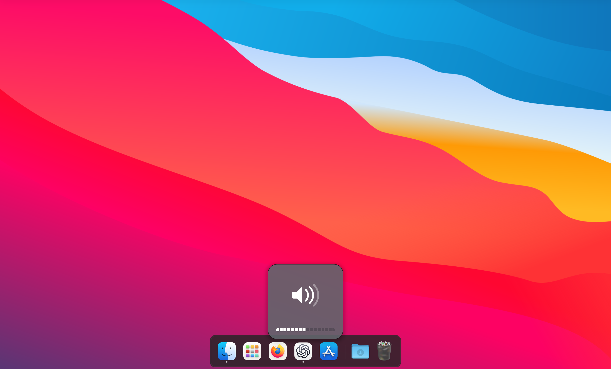

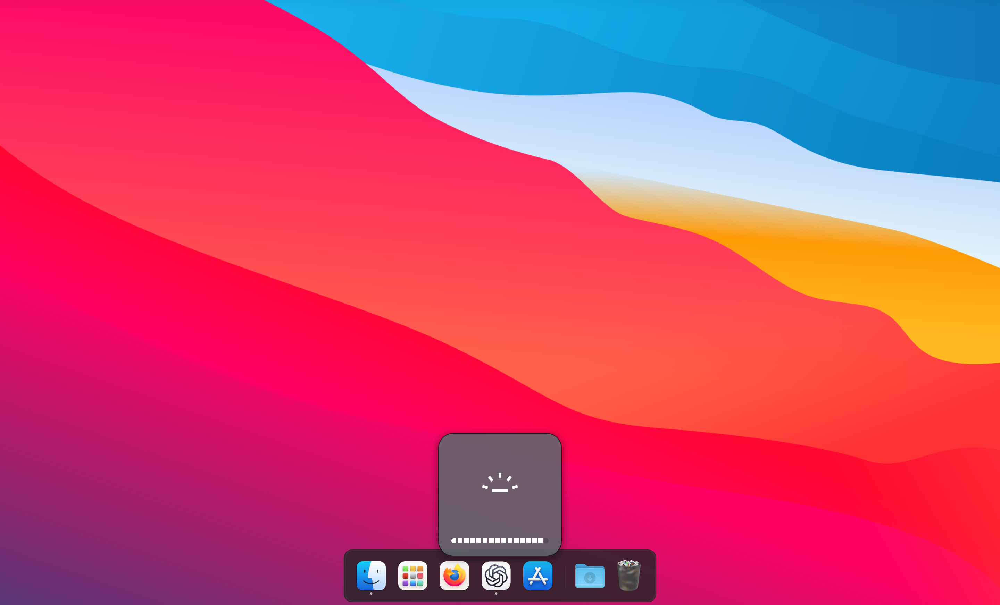

## Notification Center / Bildirim Merkezi

Date, an empty-notifications card and calendar. Existing notifications were not cleared for this capture.

Tarih, boş bildirim kartı ve takvim. Çekim için mevcut bildirimler silinmemiştir.

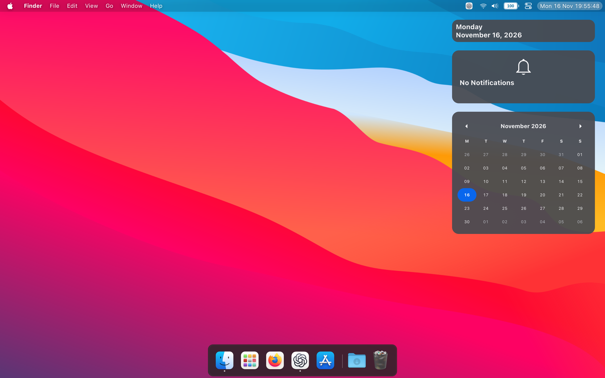

## Power menu and confirmation / Güç menüsü ve onay ekranı

The system menu and restart confirmation with countdown. The account name is redacted in the menu screenshot. The restart was cancelled immediately after capture; the computer was not restarted.

Sistem menüsü ve geri sayımlı yeniden başlatma onayı. Menü görüntüsünde hesap adı gizlenmiştir. Çekimden hemen sonra işlem iptal edilmiştir; bilgisayar yeniden başlatılmamıştır.

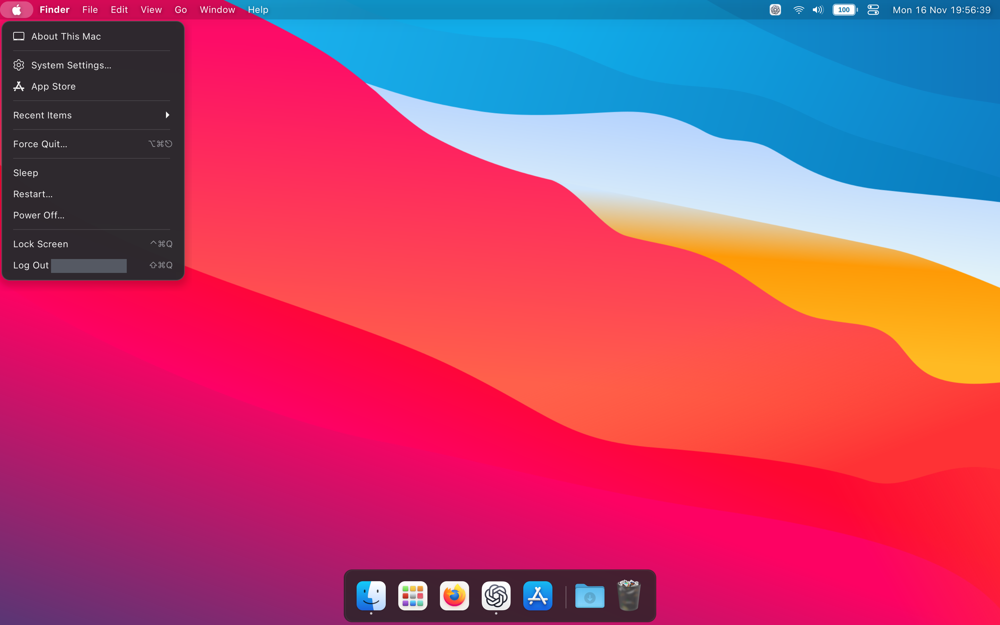

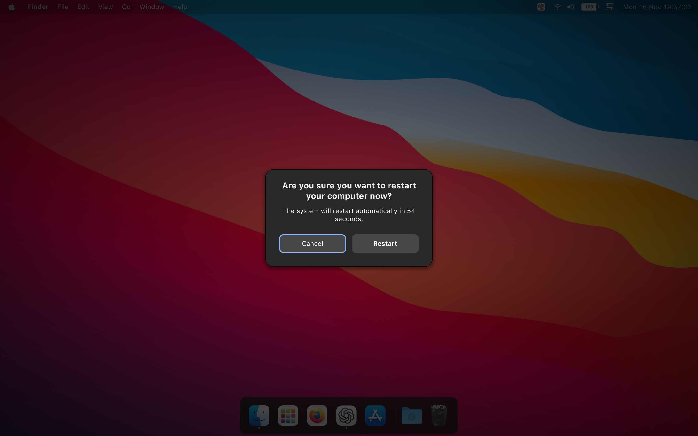

## Login screen / Giriş ekranı

Actual GDM login screen, with the account name redacted. With explicit user approval, saving screenshots was temporarily enabled for this capture, then the original GDM database was restored and `disable-save-to-disk=true` verified. The existing desktop session remained open.

Gerçek GDM giriş ekranı; hesap adı gizlenmiştir. Kullanıcının açık onayıyla çekim için ekran görüntüsü kaydı geçici olarak açıldı, ardından özgün GDM veritabanı geri yüklendi ve `disable-save-to-disk=true` doğrulandı. Mevcut masaüstü oturumu açık kaldı.

## README detail crops / README ayrıntı görselleri

The English and Turkish READMEs show feature crops from these same captures. Each crop links to its full source image. To regenerate the crops with Pillow installed: `python3 scripts/build-screenshot-details.py`. This does not change the original captures or their privacy redactions.

İngilizce ve Türkçe README dosyaları bu görüntülerden kırpılmış özellik görsellerini gösterir. Her kırpım tam kaynak görüntüye bağlantı verir. Pillow kurulu geliştirme ortamında yeniden üretmek için: `python3 scripts/build-screenshot-details.py`. Asıl görüntüler ve gizlilik için kapatılan alanlar değişmez.

## Sources / Kaynaklar

See [sources and licenses](../THIRD_PARTY.md) for the themes, icons and other upstream components visible in these screenshots. The original A1398 vector illustration is in [assets/hardware](../assets/hardware/macbook-pro-a1398.svg). Application names and marks belong to their respective owners.

[Back to README](../README.md) · [Türkçe](README.tr.md)
