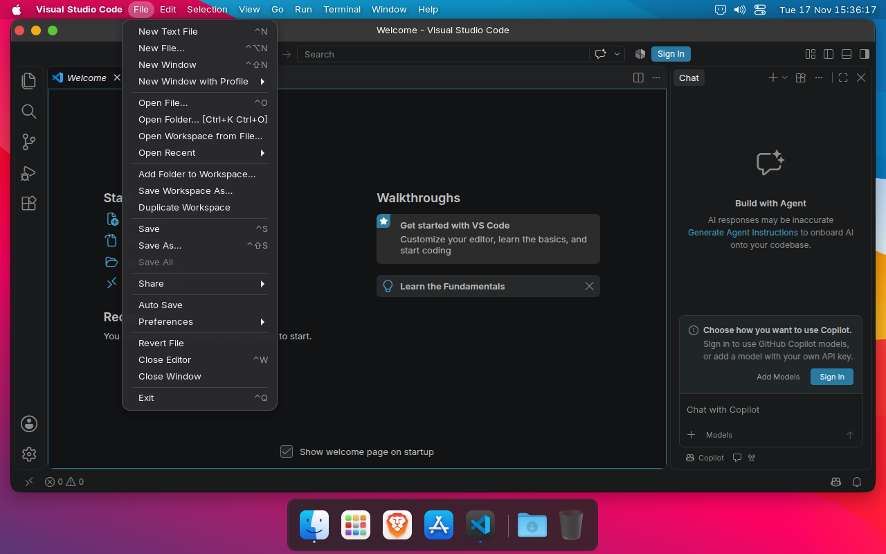
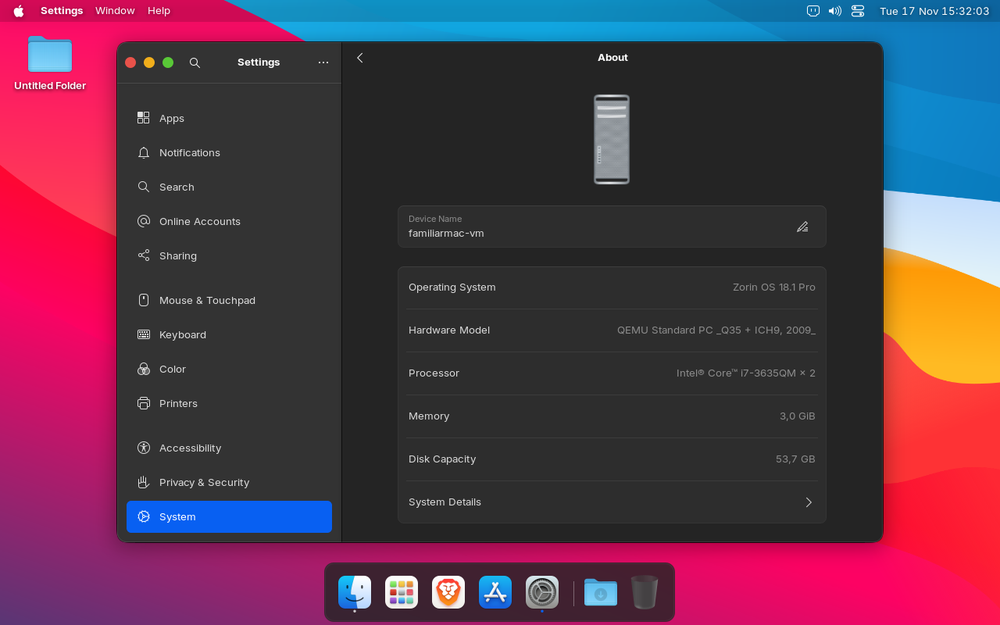
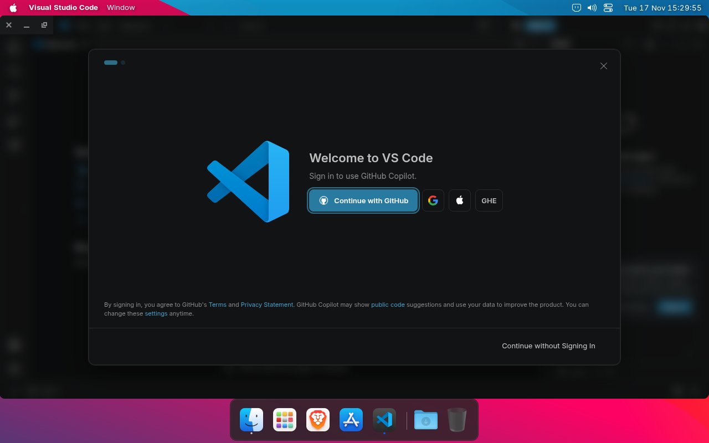
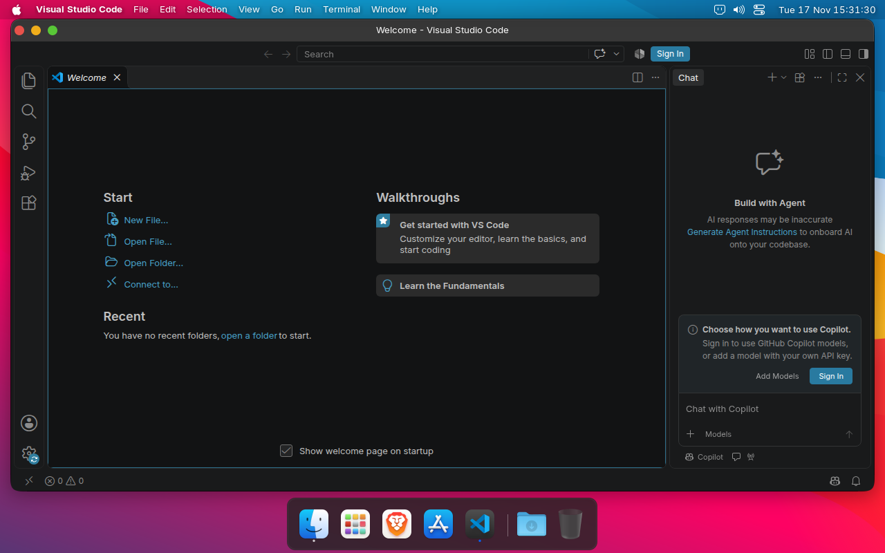
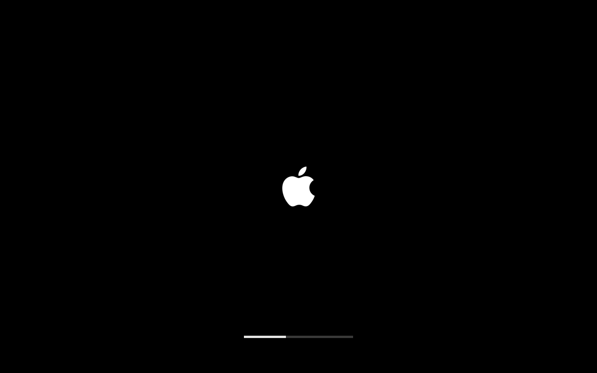
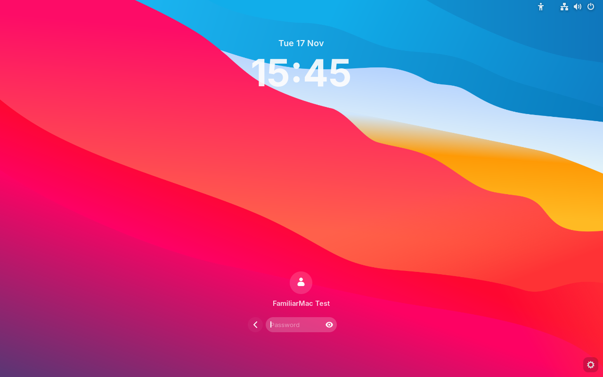

# Clean Zorin VM validation — 2026-11-17

This is a real installed guest and logged-in Wayland session, not a screenshot
mockup or the isolated-HOME test. It exposed installation assumptions that were
not visible on the original configured MacBook.

## Environment and boundaries

- Zorin OS **18.1 Pro, minimal installation**, GNOME Shell 46, x86_64.
  The verified USB installation image was used. The official Core 18.1 ISO was
  also downloaded and checksum-verified, but **a separate Core installation has
  not been completed**. Do not describe this as a Core end-to-end pass.
- QEMU/KVM, Q35, two virtual CPUs, 3 GiB RAM, 50 GiB virtual disk,
  virtual GPU/network only. No physical disk, NVIDIA GPU or Wi-Fi passthrough.
- The guest's distro installer selected kernel `7.0.0-43-generic`; this did not
  change the physical computer's kernel or boot configuration.
- A clean-disk snapshot was taken before installing FamiliarMac. Installation
  used the working tree, including the fixes below, rather than an older release.
- Host boot/module/initramfs/NetworkManager checks: **370 readable files,
  zero changed**. Guest protected configuration: **371 files, zero changed**
  through desktop installation and application tests.

## Tested path and observed results

1. `./install.sh --check` identified missing build dependencies and the Q35 model.
2. `./install.sh --prepare-desktop` installed real distro dependencies and built
   the shared theme/icon assets. `./install.sh --desktop` completed as the normal
   guest user. No hardware profile was selected.
3. `./install.sh --full` rejected the foreign model before privileged commands.
4. Logout/login loaded the actual extensions. The upper menu bar and separate
   Dock worked after correcting the fresh-preset assumptions below.
5. Mousepad `0.6.2` and official native VS Code `1.146.0` were installed afterward.
   The package watcher ran automatically. Mousepad's real menu was displayed.
   New VS Code package identity and native Electron support gaps were found and
   fixed; subsequent adaptation used the shared adapters.
6. VS Code's File menu displayed real accelerators. Clicking **New Text File**
   created `Untitled-1`; pressing **Ctrl+N** created `Untitled-2`. A second window
   retained the menu order. Exported shortcuts show Control on a portable setup
   without the reference keyboard mapper, rather than claiming Command remapping.
7. For a controlled first-profile race, the disposable guest Code profile and
   adaptation records were backed up, the watchers were paused, a new real Code
   profile was opened, and the watchers resumed. The timer reported
   `waiting-for-exit` and did not create settings while Code was running. After
   normal exit it reported `checked`, wrote `window.titleBarStyle: native`, and
   the next real launch displayed the theme's window controls and exported menus.
   No adapter was manually invoked to complete that deferred transition.
8. Files' exported **New Tab** action opened a real second tab. The default
   upstream Nautilus exclusion no longer substitutes desktop actions for its
   focused window.
9. **About This Mac** opened Settings → About, retained real QEMU hardware/OS
   fields, and automatically selected the generic desktop illustration.
10. A guest reboot retained the layout, menu exporter and watcher services.
    Zorin Dash was also upgraded inside the guest from `104` to the shared
    repository's `110.1`; the subsequent login kept a working Dock and top panel.
    No failed user units or Shell JS/extension exceptions were found in that boot.

| Fresh profile while application is running | Next launch after automatic deferred application |
|---|---|
|  |  |

## Fixes prompted by the VM

- Explicitly select the separate Zorin Dock and disable the competing taskbar.
  Core's image manifest lacks Zorin Dash; preparation now installs it from the
  shared Zorin repository when absent, without upgrading an existing Dock.
- Respect session-mode enabled extensions by reconciling both enabled and disabled
  lists. Do not enable the optional keyd extension when its mapper is absent.
- Remove Nautilus only from the untouched upstream default blacklist; preserve
  an explicitly customized blacklist.
- Recognize the official renamed VS Code launcher IDs as well as older IDs.
- Detect native Electron menu-export capability from its installed payload and
  ELF markers. Use a user launcher with X11 for that app, preserving arguments,
  explicit backends, user-owned launchers and rollback. No executable is run
  during detection, no library is injected, and the desktop stays Wayland.
- Keep menu actors in their exported order when the menu grows, preserving
  hidden/unrelated panel actors. This fixes File incorrectly moving after Help.

The full regression suite and isolated clean-user installation/reinstallation
test passed with these changes. They supplement, rather than replace, the live
observations above.

## Remaining limits

- This is one virtual hardware/OS configuration, not validation of every old Mac,
  a separate Core installation, suspend/resume, GPU switching or physical input.
- Boot splash and the system GDM login theme remain Zorin in desktop-only mode.
  Use the separate `--system-appearance` opt-in for these visuals, never `--full`
  on another model. The optional layer was subsequently tested as described below.
- GTK applications can export usable actions without accelerator metadata.
  Mousepad's Wayland menu showed actions but no accelerator hints in this run.
  Files' action-derived menu also contains duplicate “New Window” labels for
  distinct action sources. These are remaining presentation gaps, not a claim
  of complete menu/shortcut parity across all applications.
- A cold Electron menu may briefly show Loading while its owning process builds
  the menu. No performance equivalence to physical hardware is claimed for a
  two-core software-rendered VM.
- General native Electron detection deliberately excludes wrappers it cannot
  statically resolve, explicit custom backends and custom frameless UIs without
  a supported app preference. Unsupported applications need capability review.

To repeat: start with a clean supported guest, run the three public commands in
steps 1–2, log in again, install test apps normally, inspect watcher journals and
state, then verify actual menu actions and deferred settings on screen. Never
copy the reference machine's `/etc`, firmware or boot configuration into the guest.

## Optional boot/login layer — real VM follow-up

The separate `--system-appearance` installer was applied in this guest after the
desktop tests, without the full MacBook hardware profile. Actual QMP screen
captures during reboot showed the Apple logo and progress bar, followed by the
custom GDM background, one large clock, English date, user selection and password
entry. Password authentication reached the themed desktop successfully.

Rollback restored the original Zorin GDM resource and Plymouth alternative.
Logging out displayed the original Zorin login screen; authentication back to the
desktop succeeded. A cached launcher path issue found during rollback was fixed
by retaining a plain GNOME Shell forwarding executable. The optional theme was
then reinstalled. This test does not bypass authentication, modify firmware/GRUB,
or claim that the Apple image appears before Plymouth starts.

Host protected-file comparison remained **370 unchanged**. Guest protected
configuration checks outside `/boot` also passed; rebuilding guest initramfs
images is expected and explicitly part of installing/removing this visual layer.
No physical GPU, Wi-Fi or reference-machine keyboard settings were transferred.
Encrypted-disk prompts are implemented but were not exercised in this unencrypted
VM. The VM still uses the existing Pro installation, not a separately tested Core
installation.

## Combined general installer

The public `./install.sh --all` entry point was subsequently run from the VM's
actual desktop terminal with ordinary sudo authentication. It completed
preparation, desktop/app adapters, Dock/About/trash integration and boot/login in
one invocation. This was a **reapplication in the already tested VM**, not a
second pristine OS installation; the earlier sections record the initial staged
installation. The command did not run the reference `system.sh` hardware profile.

Automated orchestration tests also cover exact stage order on an unprepared
fixture, stopping at each representative failed stage, conflicting modes,
reference hardware option rejection, dry-run non-execution and the separate
combined restore route. Full regressions passed. The host's 370 protected file
hashes remained unchanged.

After the combined run, a manual guest reboot again reached the custom login
screen; successful authentication reached the themed desktop. There were no
failed user units, the application integration path watcher was active, and the
guest protected configuration hashes outside `/boot` still matched the original
baseline.
